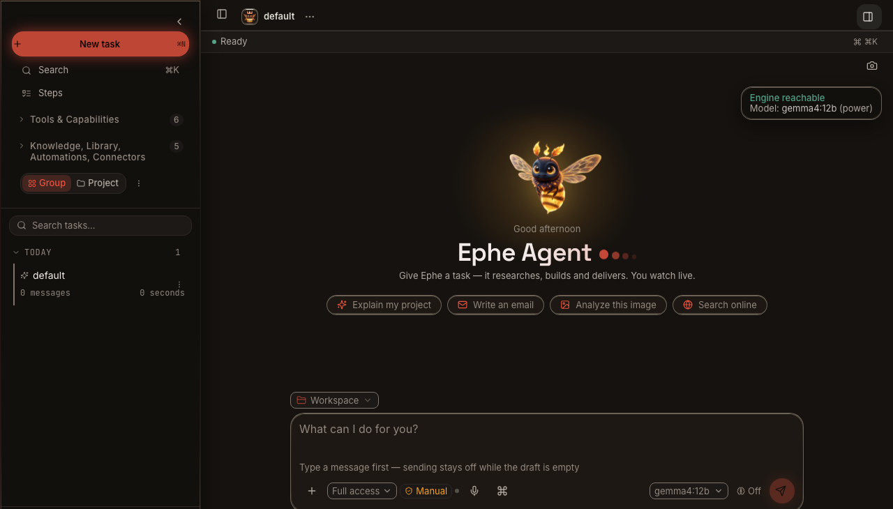
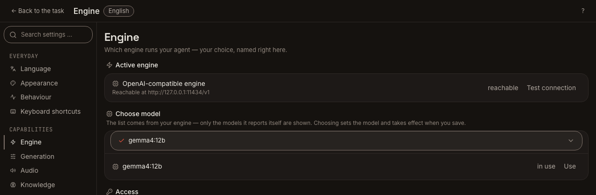
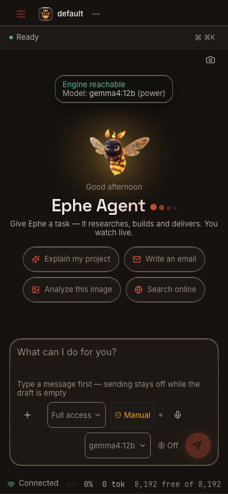

<p align="center"><a href="README.md">English</a> | <a href="README.zh-CN.md">中文</a> | <a href="README.es.md">Español</a></p>

<!-- canonical: README.md is authoritative -->
> **La versión en inglés es la referencia oficial.** Esta traducción puede quedar desactualizada; prevalece [README.md](README.md).

<div align="center">


# Ephe

**Ephe es un espacio de trabajo local para un agente de IA en tu propio ordenador. Tú eliges el motor y el modelo, apruebas las herramientas y conservas los archivos. No hay cuenta ni modelo predeterminado oculto.**

[](https://python.org)
[](LICENSE)
[](https://github.com/bemlerlabs/ephe/actions/workflows/tests.yml)
[](https://github.com/bemlerlabs/ephe/actions/workflows/frontend-build.yml)

</div>



- **Privado por defecto.** Con un motor local, tus instrucciones se quedan en tu ordenador. Las funciones en línea requieren tu activación.
- **Tu modelo.** Elige un modelo local de Ollama o un endpoint compatible con OpenAI. Ephe nunca elige por ti.
- **Tus archivos.** Trabaja en la carpeta que elijas. Los archivos que genera el agente se guardan en tu ordenador.

## Qué es Ephe

Ephe es un espacio de trabajo para un agente de IA en tu ordenador. Le das una tarea; el agente elabora un plan, utiliza herramientas y muestra el trabajo mientras lo realiza. En el perfil estricto predeterminado, las modificaciones de archivos y los comandos de shell requieren tu aprobación.

El motor responde con un modelo. Un motor local como Ollama ejecuta el modelo en tu hardware; un endpoint compatible con OpenAI lo ejecuta en el proveedor que elijas. Ephe no incluye pesos de modelos ni selecciona un modelo predeterminado.

Un plugin agrupa comandos y un paquete de habilidades; una habilidad es un conjunto de instrucciones reutilizables; un conector enlaza una herramienta externa. Los servidores MCP se configuran a mano. El paquete Superpowers se instala en tu propio perfil desde la Tienda de plugins tras una confirmación.

Cada ejecución es una celda: un espacio de trabajo desechable para la sesión. Los archivos que conserves y los ajustes que guardes permanecen en el disco, y el banco de trabajo conserva los archivos del agente para que puedas abrirlos, descargarlos o incorporarlos.

## Qué puedes hacer

Estos flujos se incluyen como plugins propios. El chat identifica el resultado de la herramienta que respalda cada paso.

| Tarea | Qué se incluye |
|---|---|
| Redactar un documento a partir de fuentes | [documents](plugins/documents) y [local-document-factory](plugins/local-document-factory) generan PDF o DOCX con fuentes y un paso de verificación |
| Crear una presentación o una hoja de cálculo | [presentations](plugins/presentations) genera PPTX con evidencias; una nota del orador permanece en la especificación y el pptx no lleva página de notas. [spreadsheets](plugins/spreadsheets) crea una hoja XLSX con entradas, supuestos y fórmulas en filas etiquetadas |
| Investigar con fuentes fechadas | [web-research](plugins/web-research) conserva URL directas, fechas y citas; el acceso web requiere tu activación |
| Navegar una página con un navegador real | [browser-use](plugins/browser-use) navega, hace clic y escribe bajo la puerta de aprobación |
| Reproducir un error y demostrar la corrección | [code-shell](plugins/code-shell) reproduce el defecto, aplica la corrección mínima y la verifica con pruebas |
| Guardar notas que puedas recuperar | [memory](plugins/memory) guarda, recupera y elimina datos tras tu confirmación; [private-research-notebook](plugins/private-research-notebook) elabora respuestas citadas a partir de fuentes locales |
| Mantener una cuenta atrás a la vista | [countdown](plugins/countdown) declara una superficie flotante y un temporizador que el agente ajusta y lee |
| Guardar una imagen a partir de una descripción | [image-studio](plugins/image-studio) llama a un endpoint de imágenes y escribe un archivo .png |

Elige el motor adecuado para tu ordenador:



Trabaja en una ventana del tamaño de un teléfono a través de tu propia red:



## Qué ocurre durante una tarea

1. Escribes una tarea en el cuadro de entrada. El agente la convierte en un plan.
2. Utiliza una herramienta, por ejemplo para leer un archivo o ejecutar un comando. El perfil estricto exige aprobación para modificar archivos y ejecutar comandos de shell.
3. El resultado aparece en el chat. Los archivos y gráficos llegan al banco de trabajo, donde puedes abrirlos o incorporarlos.
4. La celda de la sesión termina. Los archivos y ajustes que hayas guardado permanecen en el disco.

Cada resultado de una herramienta queda vinculado al turno que lo produjo. Las afirmaciones sobre un archivo proceden de resultados reales de herramientas, no de la memoria del modelo.

## Escritorio, terminal y teléfono

El escritorio y el navegador comparten una aplicación web instalable (PWA) y un solo backend en Python. `ephe desktop` compila e instala la aplicación de escritorio; `ephe start --open` abre la aplicación en el navegador. Una compilación escribe `Ephe.app` en `app/src-tauri/target/`; esa copia no es una instalación. `ephe desktop` coloca la aplicación en `/Applications`, elimina la copia de compilación y el botón de actualización reescribe el paquete instalado.

La terminal (`ephe`) usa el motor elegido en `~/.ephe/engine.json` y ofrece su propia configuración cuando todavía no hay ninguno. `ephe status` indica si un backend responde en el puerto y si esta instalación es su dueña; `ephe stop` detiene el que esta instalación inició y nunca mata un proceso que no pueda demostrar.

Un teléfono en tu red local puede abrir la PWA después de ejecutar `ephe start --lan --open`; el acceso público es una opción independiente que debes activar.

## Inicio rápido

### 1. Instalar

#### macOS y Linux

```bash
curl -fsSL https://raw.githubusercontent.com/bemlerlabs/ephe/v0.7.0/install.sh | bash -s -- --tag v0.7.0
```

Para leer el script antes de ejecutarlo, usa el repositorio:

```bash
git clone https://github.com/bemlerlabs/ephe.git
cd ephe
./install.sh
```

El instalador prepara Python y el entorno local, compila la aplicación web y la inicia en `http://127.0.0.1:8765`. Si macOS pregunta si quieres abrir la aplicación, usa Ajustes del Sistema → Privacidad y seguridad → Abrir igualmente.

#### Windows (PowerShell)

```powershell
irm https://raw.githubusercontent.com/bemlerlabs/ephe/v0.7.0/install.ps1 -OutFile install.ps1
powershell -ExecutionPolicy Bypass -File .\install.ps1 -Ref v0.7.0
```

Desde un repositorio local, ejecuta el mismo `powershell -ExecutionPolicy Bypass -File .\install.ps1` después de abrir PowerShell en esa carpeta.

La instalación en Windows aún no está verificada de extremo a extremo para esta revisión. Los comandos están documentados, pero falta una prueba en una máquina o VM con Windows.

#### Docker

Docker y todas las opciones del instalador se describen en [docs/INSTALL_OPTIONS.md](docs/INSTALL_OPTIONS.md).

El comando nombra la versión que incluye este árbol, `v0.7.0`; la etiqueta resuelve cuando se publica. El instalador de Bash usa `--desktop` por defecto; pasa `--cli` o define `EPHE_MODE=cli` para instalar solo la terminal.

Antes de usar `ephe` en una terminal nueva, activa el entorno instalado.
Para la instalación predeterminada en macOS o Linux:

```bash
source "$HOME/Documents/Ephe/.venv/bin/activate"
```

Para la instalación predeterminada en Windows:

```powershell
& "$HOME\Documents\Ephe\.venv\Scripts\Activate.ps1"
```

Para un repositorio o una ubicación personalizada, usa el `.venv` de esa carpeta.

### 2. Elegir el motor

La aplicación abre la página de configuración (Setup). Elige un modelo local de Ollama, un Ollama remoto o un endpoint compatible con OpenAI. Para la terminal, `ephe configure` escribe la misma elección en `~/.ephe/engine.json`. Sin una elección, la aplicación permanece en Configuración (Setup) y los comandos sin interfaz se detienen con instrucciones; no hay un valor oculto.

Para un endpoint alojado, introduce su clave en la misma página. La aplicación la guarda en el llavero del sistema o en `~/.ephe/engine.key` con permisos solo para el propietario. Nunca se escribe en `engine.json` ni se imprime en el chat. La clave guardada queda vinculada a este motor en un archivo lateral, `~/.ephe/engine.key.binding.json`, que contiene un SHA-256 de la clave, no la clave. La aplicación rechaza una clave guardada sin esa vinculación.

### 3. Preguntar

Abre `http://127.0.0.1:8765` o ejecuta `ephe start --open`. La aplicación de escritorio se compila desde la misma app; `ephe desktop` la instala. Desde la terminal, `ephe` abre la interfaz de texto; la misma superficie responde a `ephe tui`. Escribe una tarea. El perfil estricto pregunta antes de modificar archivos o ejecutar comandos de shell.

Para usar el mismo espacio de trabajo desde un teléfono en tu red, ejecuta `ephe start --lan --open` y abre Ajustes (Settings) → Móvil (Mobile). Pulsa **Conectar móvil (Connect mobile)**. Escanea el código QR y abre la PWA en el teléfono. El acceso público es una opción independiente; la guía está en [docs/MOBILE.md](docs/MOBILE.md).

## Qué necesitas

| Necesidad | Detalle |
|---|---|
| Ordenador | macOS 13+ o Ubuntu 22+; un navegador actual; las instrucciones de PowerShell para Windows siguen sin verificar de extremo a extremo |
| RAM | 8 GB libres para un modelo local pequeño; 16 GB o más para un modelo de clase 12B; un motor remoto necesita menos |
| Disco | 4 GB para la aplicación y sus dependencias; más para el modelo que elijas |
| Herramientas de compilación | Node.js 22.23.4 es el entorno de compilación probado; Node.js 20 LTS es el mínimo del instalador. Python 3.11 o superior; `.python-version` fija la serie 3.13 |
| Motor | Un modelo local de Ollama o un endpoint compatible con OpenAI y su clave; ninguna cuenta de Ephe |

Un modelo local usa la RAM y el disco de la máquina que lo ejecuta. Un endpoint alojado necesita conexión de red, una URL de endpoint y una clave de API. Un motor local no necesita clave. Ephe no incluye ningún modelo y no pide cuenta. Para un modelo local, descarga una etiqueta primero: `ollama pull <tag>`.

## Cuánto cuesta

Ephe no tiene suscripción ni cuenta. Un modelo local usa tu hardware; un motor alojado te factura directamente según sus condiciones. La inferencia local no tiene coste de proveedor y el uso no productivo es gratuito. El uso en producción requiere una licencia comercial, sea cual sea el motor. El código está disponible bajo BUSL-1.1; las condiciones están en [COMMERCIAL.md](COMMERCIAL.md).

## Privacidad y control

Un motor local mantiene la instrucción en tu máquina. Un motor remoto, la búsqueda web, el acceso móvil público y la síntesis de voz en la nube envían lo que pides a ese servicio; cada uno requiere tu activación.

La clave del motor permanece en el llavero del sistema o en `~/.ephe/engine.key` con permisos solo para el propietario. La página de ajustes y `ephe configure` la escriben; Ephe no la imprime.

Elige el modo de respuesta en la cabecera: Analyst, Architect, Operator o Creator. El perfil de aprobación del cuadro de entrada es el techo por encima del modo, y el perfil estricto predeterminado pregunta antes de modificar archivos y ejecutar comandos de shell. Los modos opcionales y las aprobaciones recordadas pueden permitir la ejecución sin otra pregunta. La celda de la sesión se destruye al terminar; los archivos y ajustes guardados permanecen en el disco.

No hay cuenta ni registro. La comprobación de actualizaciones consulta a GitHub cuál es la versión más reciente (y, en el canal commit opcional, la punta de main); cualquier otro acceso de red espera a que actúes. Las funciones en línea opcionales aparecen en Setup y Settings. Los detalles están en [docs/SECURITY_AND_PRIVACY.md](docs/SECURITY_AND_PRIVACY.md) y [SECURITY.md](SECURITY.md).

## Plugins, habilidades y conectores

Ephe incluye nueve plugins propios, siete preajustes de capacidades, cinco paquetes de habilidades propios y un paquete de habilidades de terceros incluido (Superpowers, MIT). Un plugin añade comandos y un paquete de habilidades; una habilidad es un conjunto de instrucciones reutilizables; un preajuste ofrece una capacidad sin atribuirle la calidad de un plugin. La aplicación también incluye sus habilidades integradas; consulta [docs/SKILLS.md](docs/SKILLS.md).

Los nueve plugins propios y los cinco paquetes de habilidades propios se distribuyen con la aplicación. La Tienda de plugins (Plugin Store) en Ajustes (Settings) muestra qué puede hacer cada entrada. El paquete Superpowers se incluye como contenido de terceros y se instala en tu propio perfil tras una confirmación, porque no está firmado. Está previsto un catálogo público para editores externos.

Puedes añadir servidores MCP (MCP servers) a mano en Ajustes (Settings) → Servidores MCP. Su catálogo ofrece indicaciones de configuración y enlaces a la documentación; no instala esos servidores externos.

## Qué falta todavía

- No hay aplicación para iOS ni Android. La superficie móvil es la PWA sobre tu propia red.
- No hay pesos de modelos ni modelo predeterminado. Tú eliges motor y modelo.
- No hay rastreador por defecto. La investigación web requiere tu activación.
- No hay instalación con un clic de servidores MCP externos ni catálogo público para editores de terceros.
- No hay servidor multiusuario. Una instancia sirve a una persona en una máquina.
- La instalación en Windows y el arranque del navegador aún necesitan una prueba de extremo a extremo.

## Si algo falla

- **Tu comando de instalación guardado apunta a una versión anterior.** Compáralo con el comando de Inicio rápido antes de instalar.
- **La aplicación abre la configuración y no deja chatear.** Elige un motor ahí o ejecuta `ephe configure`. Un modelo local y un endpoint alojado son válidos.
- **macOS dice que la aplicación no está notarizada.** Abre Ajustes del Sistema → Privacidad y seguridad y elige Abrir igualmente.
- **PowerShell bloquea el script.** Usa `powershell -ExecutionPolicy Bypass -File .\install.ps1` en la carpeta donde descargaste el script.
- **Un modelo local va lento.** Comprueba la RAM libre; un modelo más pequeño usa menos. Un endpoint alojado mueve el trabajo fuera de esta máquina.
- **¿Dónde están mis datos y mi clave?** `~/.ephe` contiene ajustes, sesiones, archivos y registros; el llavero del sistema (preferido) o `~/.ephe/engine.key` (0600) contiene la clave del motor. `./uninstall.sh --dry-run` imprime el plan sin tocar nada; `./uninstall.sh --keep-data` elimina el repositorio y conserva `~/.ephe`; `./uninstall.sh --yes` elimina ambos.

## Documentación, contribuciones y licencia

El índice está en [docs/README.md](docs/README.md). Empieza por la [guía rápida](docs/QUICKSTART.md), la [guía de instalación](docs/INSTALL.md), [primer arranque](docs/FIRST_RUN.md), la [referencia de la CLI](docs/CLI.md), [operaciones](docs/OPERATIONS.md), [plugins](docs/PLUGINS_OVERVIEW.md), [habilidades](docs/SKILLS.md) y [seguridad y privacidad](docs/SECURITY_AND_PRIVACY.md).

- Errores y propuestas: el [gestor de incidencias](https://github.com/bemlerlabs/ephe/issues).
- Informes de seguridad: el canal privado de [SECURITY.md](SECURITY.md).
- Contribuciones: [CONTRIBUTING.md](CONTRIBUTING.md).
- Licencia: Business Source License 1.1 (BUSL-1.1), código disponible. Las condiciones están en [LICENSE](LICENSE); el uso en producción se describe en [COMMERCIAL.md](COMMERCIAL.md). Cada versión pasa a Apache 2.0 cuatro años después de su primera publicación.
