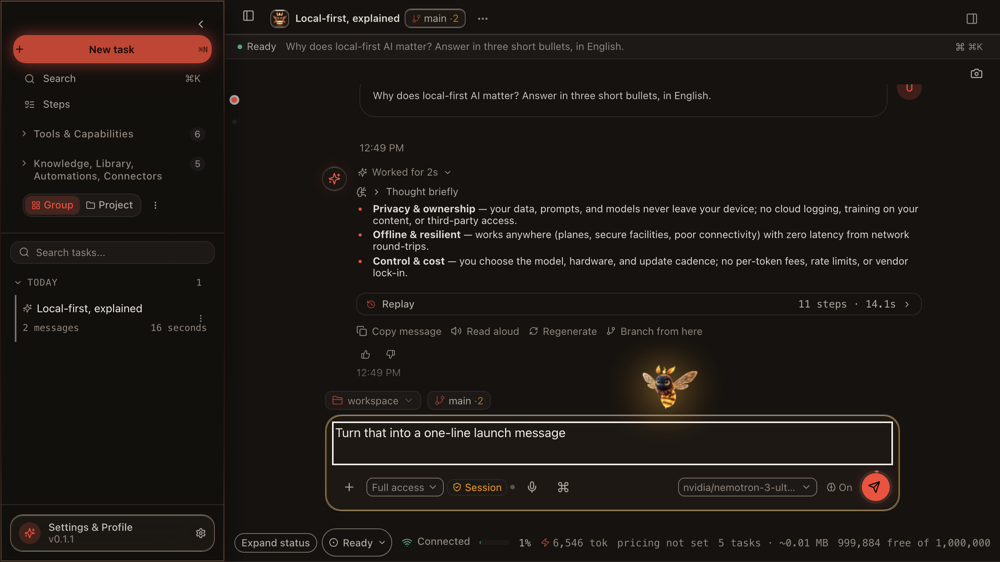

<p align="center"><a href="README.zh-CN.md">中文</a> | <a href="README.es.md">Español</a> | <a href="README.md">English</a></p>

<div align="center">


# Ephe

**Ephe es un espacio de trabajo agéntico local-first que se ejecuta en tu máquina — un agente SI efímero que controlas desde una CLI (`ephe tui`) o una app de escritorio (`ephe start`) sobre un único backend en Python. Tú eliges el motor: Ollama local, un Ollama remoto o cualquier endpoint compatible con OpenAI, y no hay ningún valor por defecto silencioso. Las funciones opcionales en línea/API siempre son opt-in.**



Un solo comando instala la app; después el motor se elige dentro de ella: Ollama local, un Ollama remoto o un endpoint compatible con OpenAI como una DGX Spark. El instalador no instala Ollama ni descarga modelos. Hasta que se elige un motor, la app lo dice y espera, sin fallback oculto; una vez elegido, una instalación totalmente offline y una instalación remota de alto rendimiento son pares. Los servidores Ollama personalizados, el acceso móvil público, la búsqueda web, los servicios de texto a voz y las API compatibles con OpenAI son rutas opcionales opt-in.

[](https://python.org) [](https://ollama.com)
[](LICENSE) [](https://github.com/bemlerlabs/ephe/actions/workflows/tests.yml) [](https://github.com/bemlerlabs/ephe/actions/workflows/frontend-build.yml)
[](README.zh-CN.md) [](README.es.md)

</div>

<div align="center">

**Las estrellas ayudan a que más gente encuentre Ephe.**

</div>

<details>
<summary>Contenido</summary>

- [Instalación rápida](#-instalación-rápida)
- [Los primeros dos minutos](#los-primeros-dos-minutos)
- [Qué puedes hacer después](#qué-puedes-hacer-después)
- [Qué es Ephe y qué no es](#qué-es-ephe-y-qué-no-es)
- [El shell de escritorio](#el-shell-de-escritorio)
- [Obtener ayuda](#obtener-ayuda)
- [Licencia](#licencia)

- [Quickstart](docs/QUICKSTART.md) · [At a Glance](docs/AT_A_GLANCE.md) · [Feature Status](docs/FEATURE_STATUS.md) · [Skills](docs/SKILLS.md) · [Plugins](docs/PLUGINS_OVERVIEW.md) · [Benchmarks](docs/BENCHMARKS.md) · [Demos](docs/DEMOS.md)
- [Install Options](docs/INSTALL_OPTIONS.md) · [CLI](docs/CLI.md) · [Architecture](docs/ARCHITECTURE.md) · [Development](docs/DEVELOPMENT.md) · [Mobile](docs/MOBILE.md) · [Telegram](docs/TELEGRAM.md) · [Security And Privacy](docs/SECURITY_AND_PRIVACY.md) · [Docs index](docs/README.md)

</details>

## ⚡ Instalación rápida

Instala con el instalador del propio repositorio — la ruta que existe hoy:

```bash
curl -fsSL https://raw.githubusercontent.com/bemlerlabs/ephe/main/install.sh | bash
```

La app aún no está notarizada: en macOS, el primer arranque pregunta una vez y hay que abrirla desde Ajustes del Sistema → Privacidad y seguridad → Abrir de todos modos.

La ruta por gestor de paquetes (`@ephemora/ephe` en npm, un cask de Homebrew, un manifiesto de Scoop) llega cuando una release la publique automáticamente; hasta entonces el comando de arriba es el que funciona; el nombre sin scope en npm pertenece a un paquete no relacionado, por eso el nuestro lleva scope.

El one-liner descarga `./install.sh` del repositorio publicado y lo ejecuta. Para leer el script antes de ejecutarlo, usa el mismo script desde un checkout:

```bash
git clone https://github.com/bemlerlabs/ephe.git && cd ephe && ./install.sh
```

Dónde coloca las cosas el instalador, qué comprueba y cómo se verifica el hash de la descarga de uv: [docs/INSTALL_OPTIONS.md](docs/INSTALL_OPTIONS.md#what-the-installer-does). Un recorrido paso a paso de la instalación, las dos formas de elegir motor y de dónde sale realmente una API key: [docs/FIRST_RUN.md](docs/FIRST_RUN.md).

### Windows (PowerShell)

```powershell
curl -fsSL https://raw.githubusercontent.com/bemlerlabs/ephe/main/install.ps1 -o install.ps1; powershell -ExecutionPolicy Bypass -File .\install.ps1
powershell -ExecutionPolicy Bypass -File .\install.ps1   # desde un checkout local
```

El modo de instalación es seleccionable: `--cli` (solo TUI/Textual, dependencias mínimas) o `--desktop`/`--gui` (por defecto, PWA más gui/voz). Sin flag, el instalador pregunta de forma interactiva.

La salida también viene con el checkout: `./uninstall.sh --dry-run` imprime el plan y no cambia nada; `./uninstall.sh --keep-data` elimina el checkout mientras `~/.ephe` se conserva. Docker, las variables de entorno del instalador y las comprobaciones de cadena de suministro están en [docs/INSTALL_OPTIONS.md](docs/INSTALL_OPTIONS.md) y [docs/INSTALL.md](docs/INSTALL.md).

### Requisitos del sistema

| Componente | Mínimo | Notas |
|---|---|---|
| SO | macOS 13+, Ubuntu 22+, o Windows con la ruta PowerShell | un navegador actual |
| Python | 3.10 o superior | `.python-version` fija 3.13 para este checkout |
| RAM | 8 GB libres para un tag local pequeño | 16 GB+ para un tag local de clase 12B; un endpoint remoto no necesita ninguna |
| Almacenamiento | 12 GB libres | 20 GB+ recomendados |

La tabla completa está en [docs/INSTALL_OPTIONS.md](docs/INSTALL_OPTIONS.md#system-requirements).

### Mapa de comandos

```bash
ephe start --open          # app web local + navegador (puerto 8765)
ephe tui                   # interfaz de terminal (Textual) sobre el motor configurado
ephe desktop               # construye el shell de Tauri, lo instala en /Applications y lo abre
ephe configure             # elige el motor una vez (se guarda en ~/.ephe/engine.json)
ephe doctor                # comprobación de instalación; `ephe doctor --fix` para reparaciones locales seguras
ephe update                # pull del repositorio + dependencias + modelo
ephe serve                 # motor compatible con OpenAI (/v1/chat/completions)
ephe session list|new|switch|rm|rename
```

Cada flag, las compuertas de aprobación y los códigos de salida están en [docs/CLI.md](docs/CLI.md).

## Los primeros dos minutos

Desde un checkout, cinco pasos hasta una sesión funcional. Cada paso numerado es un comando, y el bloque debajo es lo que esta máquina imprimió mientras se escribía la sección; las rutas absolutas largas se abrevian como `…`.

1. **Instalar.** `./install.sh` prepara Python, construye la PWA, crea las carpetas de datos bajo
   `~/.ephe/` y arranca el servidor local en `http://127.0.0.1:8765`. Añade `--dry-run` para imprimir ese
   plan sin tocar nada:

   ```text
   ▶ Checking the system
     ✓ Darwin supported
     ✓ Disk space OK
   ▶ Checking Python 3.10+
     ✓ 3.12.15 found
   ▶ Setting up the local Python environment
     DRY-RUN: pnpm --dir …/app install --frozen-lockfile
     DRY-RUN: pnpm --dir …/app run build
     ✓ PWA built → app/dist
   Setup complete.
   ```

   El mismo script es el one-liner de [Instalación rápida](#-instalación-rápida).

2. **Elegir el motor, una vez.** `ephe configure` guarda la elección en `~/.ephe/engine.json`. Hasta
   que algo se guarde ahí, la app y `ephe start` se niegan a arrancar y nombran las dos salidas:

   ```text
   $ ephe start
   Error: No engine configured.
     Fix: Run `ephe configure` and pick your engine (saved to ~/.ephe/engine.json), or set it
     explicitly via env: EPHE_MODEL_PROVIDER=local_ollama|custom_ollama|openai_compatible ...
   ```

3. **Comprobarlo.** `ephe doctor` imprime una línea por comprobación y sale con estado distinto de cero
   mientras falte algo:

   ```text
   OK      Python - 3.13.5
   OK      Engine openai_compatible - deepseek-v4-pro @ https://api.deepseek.com/v1 — engine up
   OK      Ephe server - http://127.0.0.1:8765
   OK      skills-lock.json - 51 packs match
   MISSING Voice (TTS) - piper not found — setup: 'brew install piper' ...
   Summary: 10/12 checks OK
   ```

4. **Arrancarlo.** `ephe start --open` para la app; `ephe tui` para el terminal. `ephe start --lan
   --open` también lo expone en tu red para emparejar el teléfono.

5. **Preguntar.** Esta es la llamada que hace la app contra el motor guardado en el paso 2 — la petición
   de abajo respondió en 4,7 s:

   ```text
   $ curl -s -X POST http://127.0.0.1:8765/api/chat -H 'Content-Type: application/json' \
       -d '{"message":"Answer in one short sentence: what is 17 * 3?","mode":"ask"}'
   {"response": "17 × 3 is **51**.", "model": "deepseek-v4-pro"}
   ```

Las capturas y los clips están en `docs/screenshots/` (el banner de arriba) y `docs/media/` (los clips WebP de [Demos](docs/DEMOS.md)).

## Qué puedes hacer después

Cinco cosas que este producto hace y una ventana de chat no.

1. **Elegir el motor y verlo negarse a adivinar.** `ephe configure` escribe la elección una vez; una
   máquina sin elección falla cerrada con la salida en vez de caer a un valor por defecto oculto
   ([paso 2 arriba](#los-primeros-dos-minutos)).
2. **Ver una flota trabajar en worktrees paralelos.** `ephe agents` imprime cada ejecución viva con su
   estado y antigüedad, y luego `ephe changes <workspace>` imprime lo que construyó cada ejecución —
   ruta por ruta, con el digest de cada diff:

   ```text
   $ ephe agents
   1 live workspace (register ~/.ephe/workspaces/register.json)
   cb9f70d9  probe-n1  dirty  age 8s
   $ ephe changes cb9f70d9
   1 change set for /…/workspaces/cb9f70d9 (newest first)
   cs-20261014T141323Z-b519db23  draft  1 file  2026-10-14T14:13:23  probe: one file …
       create  docs/n1-probe.txt  sha256:8031de4f05e6
   ```

3. **Poner una compuerta de revisión entre un agente y tu tronco.** `ephe review` registra un veredicto;
   aprobar tu propio trabajo se rechaza, y publicar sin veredicto también:

   ```text
   $ ephe review cs-20261014T141323Z-b519db23 approve --reviewer probe-n1 --reason "docs/n1-probe.txt:1:the author cannot approve its own set"
   Error: probe-n1 authored cs-20261014T141323Z-b519db23 and cannot approve it
     Fix: nothing was recorded: a verdict needs a reason inside the change set and a reviewer other than its author
   $ ephe publish cs-20261014T141344Z-f40dcdf2 --dry-run
   Error: cs-20261014T141344Z-f40dcdf2 may not publish: no verdict is recorded
     Fix: ephe review cs-20261014T141344Z-f40dcdf2 approve --reviewer <reviewer> --reason <path:line:why>
   ```

   Con un veredicto de un revisor que no es el autor, el mismo verbo lo registra y mueve el conjunto a
   `review`; `ephe publish --target <branch>` aterriza entonces cada archivo del conjunto o ninguno.
4. **Acotar el almacén de sesiones.** `ephe prune` informa lo que liberaría y no cambia nada; el mismo
   verbo con `--apply` lo hace:

   ```text
   $ ephe prune
   Session store: ~/.ephe/sessions
   Holds 8942 files (3.9 MB): 2666 tasks a list shows, 6276 files no list reaches.
   Dry run: would delete 2079 files, freeing 2.1 MB. Nothing was changed — repeat with --apply.
   ```

5. **Usarlo desde tu teléfono.** Arranca con `ephe start --lan --open`, abre **Settings → Mobile** en
   la app y sigue los tres pasos que muestra el panel: pulsa **Connect mobile**, escanea el código QR
   con un teléfono en la misma red y conversa desde la PWA móvil. El acceso público es un opt-in
   aparte; el recorrido está en [docs/MOBILE.md](docs/MOBILE.md).

## Qué es Ephe y qué no es

Ephe es una app web local y un backend en Python para un agente SI personal — SI aquí significa *superinteligencia*. La unidad de trabajo es la célula: se ejecuta en tu máquina, cada llamada a herramienta y cada decisión de aprobación se escriben en el registro, y la célula se destruye cuando termina la sesión. No se guarda nada a menos que tú lo guardes:

| Capacidad | Comportamiento por defecto | Comportamiento de red |
|---|---|---|
| Chat con el modelo elegido | Lo eliges tú en la app — sin valor por defecto silencioso | No requiere internet para un motor local una vez instalado su modelo |
| Comprensión de imágenes / OCR | Lo eliges tú en la app (Ollama local funciona offline) | No requiere internet una vez instalado el modelo |
| Archivos, PDFs, perfil, memoria | Disco local | No requiere internet |
| Acceso por QR al teléfono | Red local | El túnel móvil público es Optional Online |
| Acciones de shell y escritorio | Aprobación requerida | Solo local, salvo que una herramienta use internet explícitamente |
| `/research` | Deshabilitado hasta confirmación | Búsqueda web Optional Online |
| Integraciones de servicio TTS | Opcional | Internet, depende del proveedor — [Piper TTS](docs/VOICE.md) local cuando está instalado; el servicio en la nube es opt-in |
| Servidor Ollama personalizado | Advanced Opt-in | Endpoint localhost o LAN |
| API compatible con OpenAI | Advanced Opt-in | Tu proveedor de API configurado |
| Ejecución de código en sandbox (`run_sandboxed_code`) | Advanced Opt-in | `pip install 'ephe[sandbox]'` — sandbox WASI local (Ephemora Cell), sin red, sin acceso al host |

Local-first aquí significa que el producto central funciona localmente una vez que has elegido un motor en la app (Ollama o compatible con OpenAI), y que un motor local es par de los remotos. No significa que cada integración opcional sea offline, ni que haya un motor preseleccionado en silencio.

La elección de motor es la frontera que decide qué es Ephe y qué no. La build por defecto, con un motor elegido:

- **Sin servicio en la nube, sin cuenta.** La ruta local corre en tu máquina y no pide registro; no hay endpoint de telemetría: la única llamada que sale de la máquina es la comprobación de actualizaciones, que pregunta a GitHub por la última release.
- **Sin modelo y sin paquete de modelos.** Ephe no incluye pesos. El instalador detecta un Ollama en ejecución y se detiene ahí; nunca instala Ollama ni descarga un tag. Sin un motor elegido, la app espera y nombra las dos salidas.
- **Sin servidor multiusuario.** Una instancia sirve a una persona en una máquina.
- **Sin app de tienda de aplicaciones.** La superficie del teléfono es la misma PWA sobre tu red; no hay build para iOS ni Android.
- **Sin crawler por defecto.** `/research`, los motores remotos, el acceso móvil público y el TTS externo son rutas opt-in; un motor offline basta para todo lo demás.
- **Sin una segunda app nativa.** El shell de escritorio de Tauri es un envoltorio fino alrededor de la PWA; los experimentos v2 de `docs/` no son la superficie que se envía.

## El shell de escritorio

`ephe desktop` construye el shell de Tauri, lo instala en `/Applications` y lo abre. La ventana enmarca la misma PWA y el mismo backend en Python; la capa nativa debajo añade las funciones de plataforma de abajo:

```bash
ephe desktop               # construye, instala en /Applications, abre
ephe desktop --dev         # ejecuta el shell en vivo contra la URL de desarrollo
ephe desktop --no-install  # conserva la copia construida en lugar de instalarla
```

| Capacidad | Implementación |
|---|---|
| Icono de bandeja con mostrar / ocultar / salir / nueva sesión, notificaciones nativas y un diálogo de archivos nativo en lugar de una ruta escrita a mano | `app/src-tauri/src/lib.rs` (`tray-icon`), `tauri-plugin-notification`, `tauri-plugin-dialog` |
| Supervisión del backend: arranca y detiene el backend de Python registrado en `~/.ephe/desktop.json`, y nombra el registro ausente en vez de adivinar un intérprete | `app/src-tauri/src/backend.rs` |
| Clave del motor en el keychain del SO (macOS Keychain / Linux SecretService), con un archivo de clave `0600` como fallback | `core/engine_config.py` |
| Mantener despierto durante una ejecución (`caffeinate` en macOS) | `app/src-tauri/src/lib.rs` (`set_keep_awake`) |
| Panel de navegador: un WebView hijo, para que una página que envía `X-Frame-Options` cargue donde un `<iframe>` pintaba en blanco | `app/src-tauri/src/browser.rs` |
| Instancia única: un socket en el directorio de configuración frente a la app en ejecución, con `tauri-plugin-single-instance` como red de seguridad multiplataforma | `app/src-tauri/src/instance.rs` |
| Actualizador automático firmado conectado a la comprobación de actualizaciones de la propia app | `tauri-plugin-updater`, `tauri-plugin-process` |

## Obtener ayuda

El índice es [`docs/`](docs/README.md): el [quickstart](docs/QUICKSTART.md), la [guía de instalación](docs/INSTALL.md), la [arquitectura](docs/ARCHITECTURE.md), la [referencia de la CLI](docs/CLI.md), la metodología del benchmark ([benchmark-mapping.md](docs/benchmark-mapping.md)), la especificación del formato de plugins ([PLUGINS.md](docs/PLUGINS.md)), la guía del conmutador ([SWITCHING.md](docs/SWITCHING.md)) y los medios de demo.

- Bugs y peticiones de funciones: el [issue tracker](https://github.com/bemlerlabs/ephe/issues) de GitHub — las plantillas `bug_report` y `feature_request` están en el repositorio.
- Preguntas y notas de release: el [canal de Telegram](docs/TELEGRAM.md).
- Informes de seguridad: el canal privado de [SECURITY.md](SECURITY.md), nunca un issue público.
- Contribuir: [CONTRIBUTING.md](CONTRIBUTING.md) — fork, rama, añade o actualiza tests Given-When-Then, ejecuta primero las comprobaciones relevantes más estrechas y abre un pull request con la plantilla.

## Para quién es esto

**En casa, para ti.** Ephe corre en tu máquina y guarda su estado en tu máquina.
Sin cuenta, sin telemetría, sin servidor nuestro en el camino. Instálalo, úsalo, quédate con él.

**Aprender, probar, contribuir.** Bienvenido. Los tests están en este repositorio, la
arquitectura está documentada, y un pull request que arregla un bug o pule una frase vale más
que una estrella. Ver [CONTRIBUTING.md](CONTRIBUTING.md).

**Uso en producción.** Requiere una licencia comercial. Eso es todo: ejecutar Ephe para
trabajo real, en el trabajo o dentro de una empresa, o como parte de un producto o un servicio
que ofreces. La concesión es `None`, así que ninguna otra parte de la licencia lo cubre.
Pregúntanos; los niveles y el proceso están en [COMMERCIAL.md](COMMERCIAL.md).

## Licencia

Business Source License 1.1 (BUSL-1.1) — source-available y gratuita para uso no
productivo: léela, ejecútala, modifícala, construye sobre ella, evalúala, contribuye. **El uso
en producción necesita una licencia comercial**, lo que significa ejecutar Ephe para trabajo
real, en el trabajo o dentro de una empresa, o como parte de un producto o servicio que ofreces. Ver [COMMERCIAL.md](COMMERCIAL.md).

Cada versión pasa a la Licencia Apache 2.0 en el cuarto aniversario de su primera
release pública, así que todo lo publicado aquí se convierte en open source corriente cuatro
años después. Los términos operativos están en [LICENSE](LICENSE); lo que nos concedes al enviar
una contribución está en [CONTRIBUTING.md](CONTRIBUTING.md).
