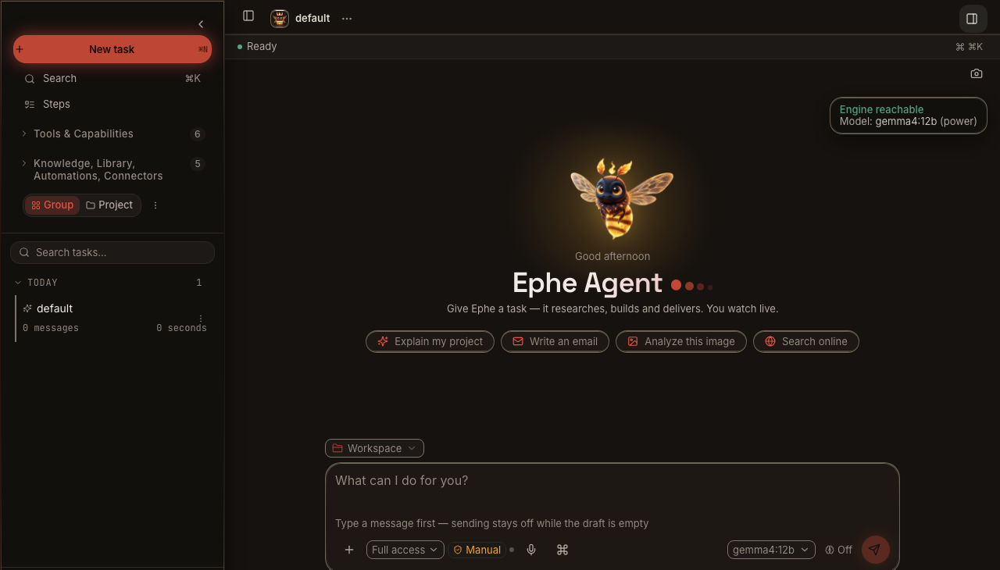
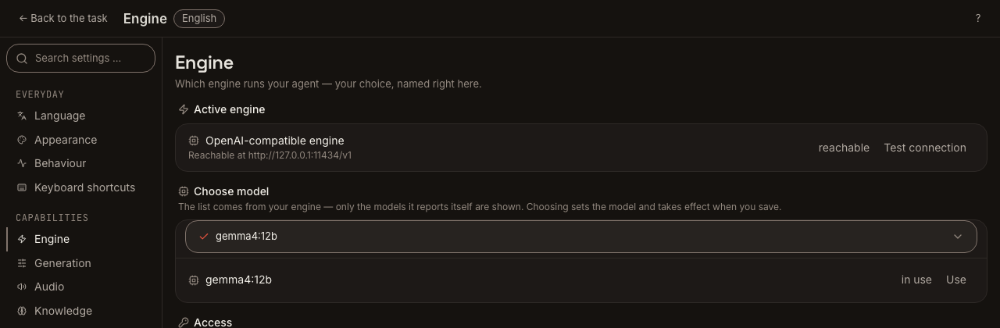
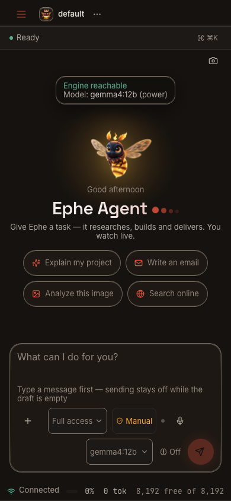

<p align="center"><a href="README.md">English</a> | <a href="README.zh-CN.md">中文</a> | <a href="README.es.md">Español</a></p>

<div align="center">


# Ephe

**Ephe is a local-first workspace for an AI agent on your own computer. You choose the engine and the model, approve the tools, and keep the files. There is no account and no hidden model default.**

[](https://python.org)
[](LICENSE)
[](https://github.com/bemlerlabs/ephe/actions/workflows/tests.yml)
[](https://github.com/bemlerlabs/ephe/actions/workflows/frontend-build.yml)

</div>



- **Private by default.** A local engine keeps your prompts on your machine. Online paths are opt-in.
- **Your model.** Pick a local Ollama model or an OpenAI-compatible endpoint. Ephe never picks one for you.
- **Your files.** Work in the folder you choose. The agent's artifacts are saved on your machine.

## What Ephe is

Ephe is a workspace for an AI agent on your computer. You give it a task; it plans, uses tools and shows the work while it runs. In the default strict profile, file edits and shell commands ask for your approval.

The engine answers with a model. A local engine such as Ollama runs the model on your hardware; an OpenAI-compatible endpoint runs it at a provider you choose. Ephe ships no weights and selects no default model.

A plugin bundles commands and a skill pack; a skill is a reusable instruction set; a connector links an external tool. MCP servers are configured by hand today, and the Superpowers pack installs into your own profile from the Plugin Store after a confirmation.

One run is a cell: a disposable workspace for the session, kept apart from the files you save.

## What you can do

These workflows ship as first-party plugins. The chat names the tool result behind each step.

| Task | What ships |
|---|---|
| Write a document from sources | [documents](plugins/documents) and [local-document-factory](plugins/local-document-factory) produce PDF or DOCX with sources and a verification step |
| Build a deck or a spreadsheet | [presentations](plugins/presentations) writes PPTX with evidence; a speaker note stays in the deck spec and the pptx has no notes page. [spreadsheets](plugins/spreadsheets) builds one XLSX sheet with labeled inputs, assumptions and formulas |
| Research with dated sources | [web-research](plugins/web-research) keeps direct URLs, dates and quoted evidence; web access is opt-in |
| Browse with a real browser | [browser-use](plugins/browser-use) navigates, clicks and types behind the approval gate |
| Prove a bug fix | [code-shell](plugins/code-shell) reproduces a defect, applies the smallest fix and proves it with a test run |
| Keep notes you can recall | [memory](plugins/memory) stores, recalls and deletes durable facts after confirmation; [private-research-notebook](plugins/private-research-notebook) builds cited answers from local sources |
| Keep a countdown in view | [countdown](plugins/countdown) adds a floating surface with a timer the agent sets and reads back |
| Save a picture from a prompt | [image-studio](plugins/image-studio) calls an image endpoint and writes a .png file |

Choose the engine that fits your machine:



Work in a phone-sized window over your own network:



## What happens in a task

1. You type a task in the composer. The agent turns it into a plan.
2. It uses a tool, such as reading a file or running a command. The strict profile requires approval for file edits and shell commands.
3. The result appears in the chat; files and charts land in the workbench, where you can open or adopt them.
4. The session cell ends. The artifacts and settings you saved stay on disk.

Each tool result stays attached to the turn that produced it, so a claim about a file comes from a real result and not from the model's memory.

## Desktop, terminal, phone

The desktop and browser share one installable web app (PWA) and one Python backend. `ephe desktop` builds the desktop shell and puts it in `/Applications`; `ephe start --open` opens the browser app. A copy under `app/src-tauri/target/` is build output, not an install.

The terminal (`ephe`) uses the engine choice from `~/.ephe/engine.json` and offers its own setup when none is chosen. `ephe status` says whether a backend answers on the port and whether this installation owns it; `ephe stop` ends the one it started and never kills a process it cannot prove.

A phone on your local network can open the PWA after `ephe start --lan --open`; public access is a separate opt-in path.

## Quick start

### 1. Install

#### macOS and Linux

```bash
curl -fsSL https://raw.githubusercontent.com/bemlerlabs/ephe/v0.6.8/install.sh | bash
```

To read the script before it runs, use the checkout:

```bash
git clone https://github.com/bemlerlabs/ephe.git
cd ephe
./install.sh
```

The installer prepares Python and the local environment, builds the web app, and starts it at `http://127.0.0.1:8765`. If macOS asks whether to open it, use System Settings → Privacy & Security → Open Anyway.

#### Windows (PowerShell)

```powershell
irm https://raw.githubusercontent.com/bemlerlabs/ephe/v0.6.8/install.ps1 -OutFile install.ps1
powershell -ExecutionPolicy Bypass -File .\install.ps1
```

From a local checkout, run the same `powershell -ExecutionPolicy Bypass -File .\install.ps1` after opening PowerShell in that folder.

Windows installation is not yet verified end to end for this revision.

#### Docker

Docker and every installer flag are described in [docs/INSTALL_OPTIONS.md](docs/INSTALL_OPTIONS.md).

The command names the release this tree ships, `v0.6.8`; the tag is published, so the URL resolves. The Bash installer defaults to `--desktop`; pass `--cli` or set `EPHE_MODE=cli` for the terminal-only install.

Before using `ephe` in a new terminal, activate the installed environment.
For the default installation on macOS or Linux:

```bash
source "$HOME/Documents/Ephe/.venv/bin/activate"
```

For the default Windows installation:

```powershell
& "$HOME\Documents\Ephe\.venv\Scripts\Activate.ps1"
```

For a checkout or custom location, use the `.venv` inside that folder instead.

### 2. Choose the engine

The app opens the Setup page. Pick a local Ollama model, a remote Ollama, or an OpenAI-compatible endpoint. For the terminal, `ephe configure` writes the same choice to `~/.ephe/engine.json`. Without a choice the app stays in Setup and the headless commands stop with instructions; there is no hidden default.

For a hosted endpoint, enter its key on the same page. The app keeps it in the OS keychain or in `~/.ephe/engine.key` (0600), never in `engine.json`, and never prints it. A sidecar, `~/.ephe/engine.key.binding.json`, binds the key to this engine by its SHA-256; a stored key without that binding is refused.

### 3. Ask

Open `http://127.0.0.1:8765` or run `ephe start --open`. The desktop shell is built from the same app. From the terminal, `ephe` opens the text interface, which also answers to `ephe tui`. The strict profile asks before file edits or shell commands.

To use the same workspace from a phone on your network, start with `ephe start --lan --open`, open Settings → Mobile. Click **Connect mobile**. Scan the QR code, then open the PWA on the phone. Public access is a separate opt-in path; the walkthrough is in [docs/MOBILE.md](docs/MOBILE.md).

## What you need

| Need | Detail |
|---|---|
| Computer | macOS 13+ or Ubuntu 22+; a current browser; Windows instructions unverified |
| RAM | 8 GB free for a small local model; 16 GB or more for a 12B-class model; a remote engine needs less |
| Disk | 4 GB for the app and its dependencies; more for the model you choose |
| Build tools | Node.js 22.23.4 is the tested build runtime; Node.js 20 LTS is the installer's floor. Python supports 3.11 or newer; `.python-version` pins the 3.13 series |
| Engine | A local Ollama model or an OpenAI-compatible endpoint and key; no Ephe account |

A local model uses the RAM and disk of the machine that runs it. A hosted endpoint needs a network connection, an endpoint URL and an API key. A local engine needs no API key. Ephe ships no model and asks for no account. For a local model, pull a tag first: `ollama pull <tag>`.

## What it costs

Ephe has no subscription and no account. A local model uses your hardware; a hosted engine bills you directly under its own terms. Non-production use is free, production use needs a commercial licence whatever the engine, and the source is available under BUSL-1.1 ([COMMERCIAL.md](COMMERCIAL.md)).

## Private and in control

A local engine keeps the prompt on your machine. A remote engine, web search, public mobile access and cloud text-to-speech send what you ask to that service; each one is opt-in. The engine key stays in the OS keychain or in `~/.ephe/engine.key` with owner-only permissions, and Ephe does not print it.

Choose the response mode in the header: Analyst, Architect, Operator or Creator. The composer's approval profile is the ceiling above it, and the default strict profile asks before file edits and shell commands. Opt-in modes and remembered approvals can allow execution without another prompt. The session cell is destroyed when the session ends; saved artifacts and settings remain on disk.

There is no account and no sign-up. The update check asks GitHub for the newest release (and, on the opt-in commit channel, the tip of main); every other network path waits for your action. The optional online features are listed in Setup and Settings. The details are in [docs/SECURITY_AND_PRIVACY.md](docs/SECURITY_AND_PRIVACY.md) and [SECURITY.md](SECURITY.md).

## Plugins, skills, and connectors

Ephe ships nine first-party plugins, seven capability presets, five first-party skill packs and one bundled third-party skill pack (Superpowers, MIT). A plugin adds commands and a skill pack; a preset is a capability without a plugin quality claim; the built-in skills are separate ([docs/SKILLS.md](docs/SKILLS.md)).

The Plugin Store in Settings shows what each entry can do. The Superpowers pack is bundled third-party content: it is not signed, so it installs into your own profile only after a confirmation. A public catalogue for external publishers is planned.

MCP servers are added by hand in Settings → MCP servers. The catalogue provides setup hints and links; it does not install those external servers.

## What is not there yet

- No iOS or Android app. The phone surface is the PWA over your own network.
- No model weights and no default model. You choose an engine and a model.
- No crawler by default. Web research is opt-in.
- No one-click installation of external MCP servers, and no public catalogue for third-party publishers.
- No multi-user server. One instance serves one person on one machine.
- Windows installation and browser startup still need an end-to-end check on Windows.

## If something goes wrong

- **Your saved install command names an older release.** Compare it with the Quick start command above before installing.
- **The app opens Setup and will not chat.** Choose an engine there, or run `ephe configure`. A local model and a hosted endpoint are both valid.
- **macOS says the app is not notarized.** Open System Settings → Privacy & Security and choose Open Anyway.
- **PowerShell blocks the script.** Use `powershell -ExecutionPolicy Bypass -File .\install.ps1` in the folder where you downloaded the script.
- **A local model feels slow.** Check free RAM first; a smaller model uses less. A hosted endpoint moves the work off this machine.
- **Where are my data and key?** `~/.ephe` holds settings, sessions, artifacts and logs; the OS keychain (preferred) or `~/.ephe/engine.key` (0600) holds the engine key. `./uninstall.sh --dry-run` prints the plan and touches nothing; `./uninstall.sh --keep-data` removes the checkout and keeps `~/.ephe`; `./uninstall.sh --yes` removes both.

## Docs, contributing, and license

The index is [docs/README.md](docs/README.md). Start with the [quickstart](docs/QUICKSTART.md), the [install guide](docs/INSTALL.md), [first run](docs/FIRST_RUN.md), the [CLI reference](docs/CLI.md), [operations](docs/OPERATIONS.md), [plugins](docs/PLUGINS_OVERVIEW.md), [skills](docs/SKILLS.md) and [security and privacy](docs/SECURITY_AND_PRIVACY.md).

- Bugs and feature requests: the [issue tracker](https://github.com/bemlerlabs/ephe/issues).
- Security reports: the private channel in [SECURITY.md](SECURITY.md).
- Contributing: [CONTRIBUTING.md](CONTRIBUTING.md).
- Licence: Business Source License 1.1 (BUSL-1.1), source-available. The terms are in [LICENSE](LICENSE); production use is described in [COMMERCIAL.md](COMMERCIAL.md). Each version falls to Apache 2.0 four years after its first public release.
