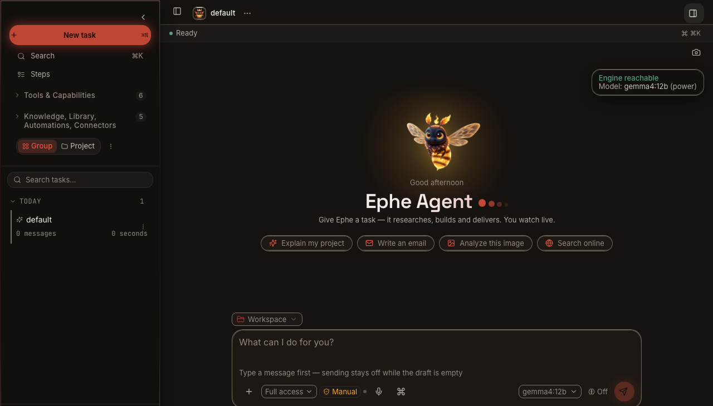
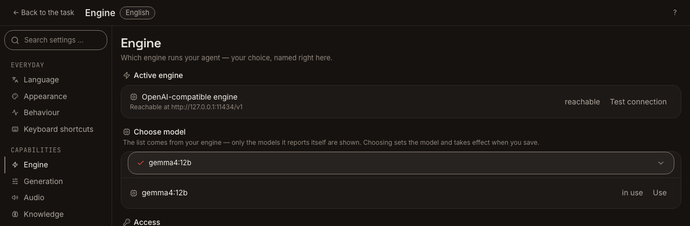
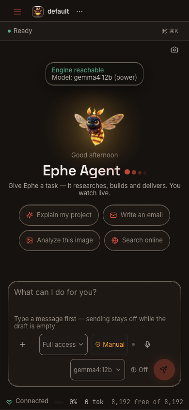

<p align="center"><a href="README.md">English</a> | <a href="README.zh-CN.md">中文</a> | <a href="README.es.md">Español</a></p>

<!-- canonical: README.md is authoritative -->
> **以英文版为准。** 本翻译可能未及时更新；请以 [README.md](README.md) 为准。

<div align="center">


# Ephe

**Ephe 是一个本地优先的 AI 智能体工作区，运行在你自己的电脑上。你选择引擎和模型，批准工具使用，并保留文件。无需账户，也没有隐藏的默认模型。**

[](https://python.org)
[](LICENSE)
[](https://github.com/bemlerlabs/ephe/actions/workflows/tests.yml)
[](https://github.com/bemlerlabs/ephe/actions/workflows/frontend-build.yml)

</div>



- **默认保护隐私。** 使用本地引擎时，提示词留在你的电脑上。联网功能需主动启用。
- **模型由你选择。** 选择本地 Ollama 模型或兼容 OpenAI 的端点。Ephe 从不替你选择。
- **文件由你保留。** 在你选定的文件夹中工作。智能体生成的文件保存在你的电脑上。

## Ephe 是什么

Ephe 是运行在你电脑上的 AI 智能体工作区。你给出任务，智能体制定计划、使用工具，并在执行过程中展示工作进展。默认的严格审批模式会在修改文件或运行 shell 命令前征求你的批准。

引擎调用模型来回答问题。Ollama 等本地引擎在你的硬件上运行模型；兼容 OpenAI 的端点则由你选择的服务商运行模型。Ephe 不附带模型权重，也不预选默认模型。

插件将命令和技能包打包在一起。技能是一组可供智能体遵循的可复用指令。连接器用于接入外部工具。目前已可手动配置 MCP 服务器。随附的 Superpowers 技能包可在扩展中心确认后安装到你的个人配置中。

Ephe 将一次运行称为一个单元（cell）。单元是会话期间使用的临时工作区。你保留的文件和保存的设置会留在磁盘上。Ephe 用 SI 指代个人超级智能：能够制定计划、在你的批准下使用工具的智能体。

工作台保存智能体生成的文件。你可以打开、下载或采纳这些文件；原始文件仍留在工作区中。

## 你可以做什么

以下工作流通过随附的第一方插件提供。对话中会标明每一步所依据的工具结果。

1. **根据一组源材料撰写文档。** [documents](plugins/documents) 和 [local-document-factory](plugins/local-document-factory) 插件生成 PDF 或 DOCX 文件，附带来源并包含核验步骤。
2. **制作演示文稿或电子表格。** [presentations](plugins/presentations) 生成带有依据和演讲者备注的 PPTX 演示文稿；[spreadsheets](plugins/spreadsheets) 构建将输入数据与假设分开列示的 XLSX 模型。
3. **使用注明日期的来源开展研究。** [web-research](plugins/web-research) 保留直达网址、日期和引用证据。网络访问需主动启用。
4. **复现缺陷并验证修复。** [code-shell](plugins/code-shell) 复现缺陷、做出最小修复，并通过运行测试验证结果。
5. **保存可随时回查的笔记。** [memory](plugins/memory) 在确认后存储、检索和删除长期保留的事实；[private-research-notebook](plugins/private-research-notebook) 根据本地来源生成带引用的回答和简报。

选择适合你电脑的引擎：



通过你自己的网络，在手机大小的窗口中工作：



## 一项任务如何进行

1. 你在输入框中输入任务，智能体将其转化为计划。
2. 智能体使用工具，例如读取文件或运行命令。严格审批模式要求修改文件和运行 shell 命令前获得批准。
3. 结果显示在对话中。文件和图表进入工作台，你可以在那里打开或采纳它们。
4. 会话单元结束。你保存的产物和设置仍留在磁盘上。

每个工具结果都关联到产生它的那一轮对话。关于文件的陈述以真实的工具结果为依据，而不是模型的记忆。

## 桌面、终端与手机

桌面端和浏览器端共用一个可安装的渐进式 Web 应用（PWA）和同一个 Python 后端。`ephe desktop` 构建并安装桌面外壳；`ephe start --open` 打开浏览器应用。

终端界面（`ephe tui`）使用 `~/.ephe/engine.json` 中保存的引擎选择。运行 `ephe start --lan --open` 后，同一局域网中的手机可以打开 PWA；公网访问是另一项需主动启用的功能。

## 快速开始

### 1. 安装

#### macOS 和 Linux

```bash
curl -fsSL https://raw.githubusercontent.com/bemlerlabs/ephe/v0.4.0/install.sh | bash
```

若想在运行前阅读脚本，可使用本地仓库副本：

```bash
git clone https://github.com/bemlerlabs/ephe.git
cd ephe
./install.sh
```

安装器准备 Python 和本地环境，构建 Web 应用，并在 `http://127.0.0.1:8765` 启动它。如果 macOS 询问是否打开应用，请前往“系统设置 → 隐私与安全性 → 仍要打开”。

#### Windows（PowerShell）

```powershell
irm https://raw.githubusercontent.com/bemlerlabs/ephe/v0.4.0/install.ps1 -OutFile install.ps1
powershell -ExecutionPolicy Bypass -File .\install.ps1
```

如果使用本地仓库副本，请在该文件夹中打开 PowerShell，然后运行同一条命令：`powershell -ExecutionPolicy Bypass -File .\install.ps1`。

当前修订版的 Windows 安装尚未经过端到端验证。上述命令已有文档说明，但仍需在 Windows 运行环境或虚拟机中进行检查。

#### Docker

Docker 和所有安装器参数的说明见 [docs/INSTALL_OPTIONS.md](docs/INSTALL_OPTIONS.md)。

上述命令指向当前公开发布的版本 `v0.4.0`。Bash 安装器默认使用 `--desktop`；如需仅安装终端界面，请传入 `--cli` 或设置 `EPHE_MODE=cli`。

在新终端中使用 `ephe` 前，请先激活已安装的环境。
对于 macOS 或 Linux 上的默认安装位置：

```bash
source "$HOME/Documents/Ephe/.venv/bin/activate"
```

对于 Windows 上的默认安装位置：

```powershell
& "$HOME\Documents\Ephe\.venv\Scripts\Activate.ps1"
```

如果使用仓库副本或自定义安装位置，请改用相应文件夹中的 `.venv`。

### 2. 选择引擎

应用会打开初始设置（Setup）页面。选择本地 Ollama 模型、远程 Ollama 或兼容 OpenAI 的端点。在终端中，`ephe configure` 会将同样的选择写入 `~/.ephe/engine.json`。未选择引擎时，Ephe 拒绝启动；没有隐藏的默认选项。

如果使用托管端点，请在同一页面输入密钥。应用将其保存在操作系统钥匙串中，或保存在仅所有者可访问的 `~/.ephe/engine.key` 文件中。密钥绝不会写入 `engine.json`，也不会输出到对话中。存储的密钥会在 `~/.ephe/engine.key.binding.json` 中绑定到该引擎，该伴生文件只保存密钥的 SHA-256，不保存密钥本身。缺少该绑定时，应用拒绝使用已存储的密钥。

### 3. 提出任务

打开 `http://127.0.0.1:8765` 或运行 `ephe start --open`。桌面外壳基于同一个应用构建；运行 `ephe desktop` 即可安装。在终端中，`ephe tui` 打开文本界面。输入任务后，严格审批模式会在修改文件或运行 shell 命令前询问你。

若要从同一网络中的手机使用这个工作区，先运行 `ephe start --lan --open`，再打开设置（Settings）→ 手机（Mobile）。点击 **连接手机（Connect mobile）**，扫描二维码，然后在手机上打开 PWA。公网访问需另行主动启用；操作说明见 [docs/MOBILE.md](docs/MOBILE.md)。

## 需要准备什么

| 项目 | 说明 |
|---|---|
| 电脑 | macOS 13+ 或 Ubuntu 22+；需要当前版本的浏览器；Windows PowerShell 安装说明尚未经过端到端验证 |
| 内存 | 小型本地模型需要 8 GB 可用内存；12B 级模型需要 16 GB 或更多；远程引擎所需内存更少 |
| 磁盘 | 12 GB 可用空间；所选模型可能需要更多空间 |
| 构建工具 | 已测试的构建运行环境为 Node.js 22.23.4，搭配 npm/pnpm 使用。Python 支持 3.11 或更新版本；`.python-version` 固定为 3.13 系列 |
| 引擎 | 本地 Ollama 模型，或兼容 OpenAI 的端点及密钥；无需 Ephe 账户 |

本地模型使用运行它的机器的内存和磁盘。托管端点需要网络连接、端点 URL 和 API 密钥。本地引擎无需 API 密钥。Ephe 不附带模型，也不要求账户。使用本地模型前，请先拉取模型标签：`ollama pull <tag>`。

## 费用

Ephe 无需订阅，也无需账户。本地模型使用你的硬件。托管引擎按服务商自己的条款直接向你收费。源码以 BUSL-1.1 许可证提供；生产使用需要商业许可证，详见 [COMMERCIAL.md](COMMERCIAL.md)。

本地推理没有服务商费用。非生产使用免费；无论使用哪种引擎，生产使用都需要商业许可证。托管服务商自行定价。

## 隐私与控制权

使用本地引擎时，提示词留在你的电脑上。远程引擎、网络搜索、公网手机访问和云端文本转语音会将你请求处理的内容发送到相应服务；每一项都需主动启用。

引擎密钥保存在操作系统钥匙串中，或保存在仅所有者可访问的 `~/.ephe/engine.key` 文件中。设置页面和 `ephe configure` 负责写入密钥；Ephe 不会输出密钥。

默认的严格审批模式会在修改文件和运行 shell 命令前询问你。主动启用的其他模式和已记住的批准可能允许执行而不再询问。请在输入框中检查审批模式。会话结束时，会话单元会被销毁；已保存的产物和设置仍留在磁盘上。

无需账户，也无需注册。更新检查会向 GitHub 查询最新版本；其他所有网络访问都等待你的操作。可选的在线功能列在初始设置（Setup）和设置（Settings）中。详情见 [docs/SECURITY_AND_PRIVACY.md](docs/SECURITY_AND_PRIVACY.md) 和 [SECURITY.md](SECURITY.md)。

## 插件、技能与连接器

Ephe 随附九个第一方插件、七个能力预设、五个第一方技能包和一个随附的第三方技能包（Superpowers，MIT）。插件添加命令和技能包；技能是一组可复用指令；预设提供某项能力，但不代表具备插件级别的质量保证。应用还附带内置技能，参见 [docs/SKILLS.md](docs/SKILLS.md)。

插件包括 documents、presentations、spreadsheets、code-shell、browser-use、web-research、memory、local-document-factory 和 private-research-notebook。预设涵盖图像处理、模型上下文协议（MCP）工具、视觉、语音、指南、插件创建和技能创建。

九个第一方插件和五个第一方技能包均随应用提供。扩展中心展示各条目的能力。Superpowers 包作为随附的第三方内容提供，由于未签名，需在确认后安装到你的个人配置中。面向外部发布者的公共目录仍在计划中。

目前可在设置（Settings）→ 连接器（Connectors）中手动添加 MCP 服务器。目录提供配置提示和文档链接，但不会安装这些外部服务器。

## 尚未提供的功能

- 没有 iOS 或 Android 应用。手机端通过你自己的网络使用 PWA。
- 不附带模型权重。引擎和模型由你选择。
- 默认不提供爬虫。网络研究需主动启用。
- 暂无外部 MCP 服务器的一键安装功能。MCP 连接需要手动配置。
- 不是多用户服务器。一个实例在一台机器上服务一个人。
- 暂无面向第三方发布者的公共目录。应用随附一个第三方包（Superpowers，MIT），其余条目均为第一方提供。
- Windows 安装和浏览器启动仍需在 Windows 上进行端到端检查。
- 暂无公共插件市场。随附的技能包可以安装；包含外部条目的市场仍在计划中。

## 遇到问题时

- **你保存的安装命令指向旧版本。** 安装前，请与上方“快速开始”中的命令进行比较。
- **应用打开初始设置（Setup）页面，但无法对话。** 在该页面选择引擎，或运行 `ephe configure`。本地模型和托管端点都可以。
- **macOS 提示应用未经公证。** 打开“系统设置 → 隐私与安全性”，选择“仍要打开”。
- **PowerShell 阻止运行脚本。** 在下载脚本的文件夹中使用 `powershell -ExecutionPolicy Bypass -File .\install.ps1`。
- **本地模型运行缓慢。** 先检查可用内存；较小的模型占用更少。托管端点可将计算转移到其他机器上。
- **数据和密钥在哪里？** `~/.ephe` 保存设置、会话、产物和日志；操作系统钥匙串（首选）或 `~/.ephe/engine.key`（0600）保存引擎密钥。`./uninstall.sh --dry-run` 输出卸载计划，不做任何更改；`./uninstall.sh --keep-data` 删除仓库副本并保留 `~/.ephe`；`./uninstall.sh --yes` 删除两者。

## 文档、贡献与许可证

文档索引在 [docs/README.md](docs/README.md)。可从[快速开始](docs/QUICKSTART.md)、[安装指南](docs/INSTALL.md)、[首次运行](docs/FIRST_RUN.md)、[CLI 参考](docs/CLI.md)、[插件](docs/PLUGINS_OVERVIEW.md)、[技能](docs/SKILLS.md)和[安全与隐私](docs/SECURITY_AND_PRIVACY.md)入手。

- 缺陷与功能请求：[问题跟踪器](https://github.com/bemlerlabs/ephe/issues)。
- 安全报告：使用 [SECURITY.md](SECURITY.md) 中的私密渠道。
- 参与贡献：[CONTRIBUTING.md](CONTRIBUTING.md)。
- 许可证：Business Source License 1.1（BUSL-1.1），源码可见。条款见 [LICENSE](LICENSE)；生产使用的说明见 [COMMERCIAL.md](COMMERCIAL.md)。每个版本在首次公开发布四年后转为 Apache 2.0。
