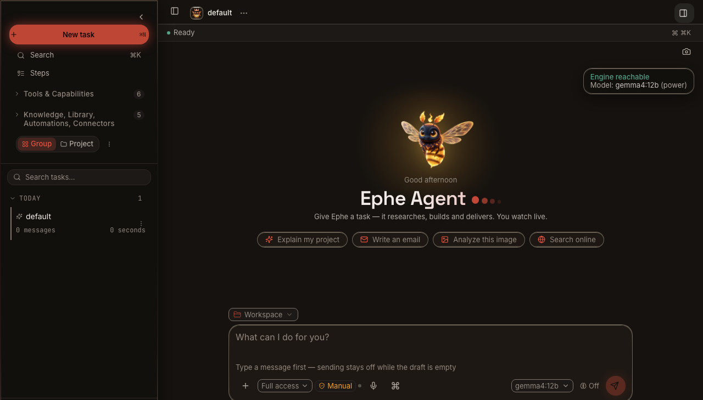
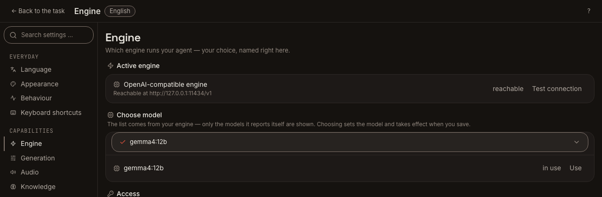
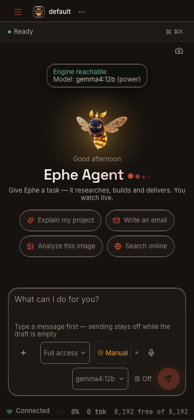

<p align="center"><a href="README.md">English</a> | <a href="README.zh-CN.md">中文</a> | <a href="README.es.md">Español</a></p>

<!-- canonical: README.md is authoritative -->
> **英文版是权威版本。** 本译文可能滞后，以 [README.md](README.md) 为准。

<div align="center">


# Ephe

**Ephe 是一个运行在你自己电脑上的、以本地优先的 AI 智能体工作区。由你选择引擎和模型，批准工具调用，并保留文件。没有账户，也没有隐藏的默认模型。**

[](https://python.org)
[](LICENSE)
[](https://github.com/bemlerlabs/ephe/actions/workflows/tests.yml)
[](https://github.com/bemlerlabs/ephe/actions/workflows/frontend-build.yml)

</div>



- **默认私密。** 本地引擎让你的指令留在自己的机器上，联网功能需要你主动开启。
- **你的模型。** 选择本地 Ollama 模型或 OpenAI 兼容端点，Ephe 从不替你选择。
- **你的文件。** 在你选定的文件夹里工作，智能体生成的文件保存在你的机器上。

## Ephe 是什么

Ephe 是一个在你电脑上运行 AI 智能体的工作区。你给它一个任务，它制定计划、使用工具，并在执行过程中展示工作。在默认的严格配置下，修改文件和执行 shell 命令都需要你批准。

引擎用模型作出回答。像 Ollama 这样的本地引擎在你的硬件上运行模型；OpenAI 兼容端点则在由你选择的提供商处运行。Ephe 不附带任何模型权重，也不替你选定默认模型。

插件打包命令和技能包；技能是一组可复用的指令；连接器连接外部工具。MCP 服务器目前需要手动配置。Superpowers 技能包会在你确认后从插件商店安装到你的个人配置中。

每次运行称为一个 cell：为本次会话准备的一次性工作区。你保留的文件和保存的设置留在磁盘上，工作台会保留智能体产出的文件，供你打开、下载或采用。

## 你可以做什么

以下流程以第一方插件形式随应用提供。聊天会标明每一步背后的工具结果。

| 任务 | 随附能力 |
|---|---|
| 依据资料编写文档 | [documents](plugins/documents) 和 [local-document-factory](plugins/local-document-factory) 生成带来源和校验步骤的 PDF 或 DOCX |
| 制作演示文稿或电子表格 | [presentations](plugins/presentations) 生成带证据的 PPTX；演讲者备注保留在演示文稿规范中，pptx 不含备注页。[spreadsheets](plugins/spreadsheets) 生成一张 XLSX 表，输入、假设和公式都是带标签的行 |
| 带日期来源的调研 | [web-research](plugins/web-research) 保留直接 URL、日期和引文；网页访问需要你主动开启 |
| 用真实浏览器访问网页 | [browser-use](plugins/browser-use) 在审批门之后导航、点击和输入 |
| 复现缺陷并证明修复 | [code-shell](plugins/code-shell) 复现缺陷、应用最小修复，并用测试运行证明 |
| 保存可随时取回的笔记 | [memory](plugins/memory) 在你确认后保存、取回和删除长期事实；[private-research-notebook](plugins/private-research-notebook) 依据本地资料生成带引用的回答 |
| 让倒计时始终可见 | [countdown](plugins/countdown) 声明一个浮动界面，以及智能体可设置和读取的计时器 |
| 根据描述保存图片 | [image-studio](plugins/image-studio) 调用图像端点并写出一个 .png 文件 |

选择适合你机器的引擎：



在你自己的网络上用手机大小的窗口工作：



## 一项任务如何进行

1. 你在输入框里写下一个任务，智能体把它变成计划。
2. 它使用工具，例如读取文件或运行命令。严格配置会要求你批准修改文件和执行 shell 命令。
3. 结果显示在聊天中。文件和图表进入工作台，你可以在那里打开或采用它们。
4. 会话 cell 结束。你保存的文件和设置留在磁盘上。

每个工具结果都附着在产生它的那一轮上。关于文件的说法来自真实的工具结果，而不是模型的记忆。

## 桌面、终端与手机

桌面端和浏览器共用同一个可安装的 Web 应用（PWA）和一个 Python 后端。`ephe desktop` 编译并安装桌面应用；`ephe start --open` 在浏览器中打开应用。构建会在 `app/src-tauri/target/` 下写出 `Ephe.app`，那份副本不是安装。`ephe desktop` 会把应用放进 `/Applications` 并删除构建副本，更新按钮会重写已安装的包。

终端（`ephe`）使用 `~/.ephe/engine.json` 里的引擎选择，在尚未选择时提供自己的设置流程。`ephe status` 说明端口上是否有 Ephe 后端应答、本次安装是否拥有它；`ephe stop` 结束本次安装启动的后端，绝不杀死无法证明归属的进程。

本地网络中的手机可以通过 `ephe start --lan --open` 打开 PWA；公网访问是需要单独开启的路径。

## 快速开始

### 1. 安装

#### macOS 和 Linux

```bash
curl -fsSL https://raw.githubusercontent.com/bemlerlabs/ephe/v0.6.8/install.sh | bash
```

要在运行前阅读脚本，请使用仓库：

```bash
git clone https://github.com/bemlerlabs/ephe.git
cd ephe
./install.sh
```

安装程序会准备 Python 和本地环境、构建 Web 应用，并在 `http://127.0.0.1:8765` 启动。如果 macOS 询问是否打开应用，请前往“系统设置”→“隐私与安全性”→“仍要打开”。

#### Windows（PowerShell）

```powershell
irm https://raw.githubusercontent.com/bemlerlabs/ephe/v0.6.8/install.ps1 -OutFile install.ps1
powershell -ExecutionPolicy Bypass -File .\install.ps1
```

在本地仓库中，打开 PowerShell 进入该文件夹后运行同样的 `powershell -ExecutionPolicy Bypass -File .\install.ps1`。

本版本的 Windows 安装尚未经过端到端验证。命令已有文档，但仍缺少 Windows 运行器或虚拟机的验证。

#### Docker

Docker 和安装程序的全部参数见 [docs/INSTALL_OPTIONS.md](docs/INSTALL_OPTIONS.md)。

命令指向本代码树自带的发行版 `v0.6.8`；标签在发布后解析。Bash 安装程序默认使用 `--desktop`；只安装终端时传入 `--cli` 或设置 `EPHE_MODE=cli`。

在新的终端里使用 `ephe` 之前，先激活已安装的环境。
macOS 或 Linux 的默认安装：

```bash
source "$HOME/Documents/Ephe/.venv/bin/activate"
```

Windows 的默认安装：

```powershell
& "$HOME\Documents\Ephe\.venv\Scripts\Activate.ps1"
```

仓库或自定义位置请使用该文件夹内的 `.venv`。

### 2. 选择引擎

应用会打开设置页（Setup）。选择本地 Ollama 模型、远程 Ollama 或 OpenAI 兼容端点。在终端里，`ephe configure` 会把同样的选择写入 `~/.ephe/engine.json`。没有选择时应用停留在设置页（Setup），无界面命令会给出提示后停止；不存在隐藏的默认值。

使用托管端点时，在同一页面输入密钥。应用把它保存在系统钥匙串或权限为仅所有者可读的 `~/.ephe/engine.key` 中，绝不写入 `engine.json`，也不会在聊天中打印。保存的密钥通过旁路文件 `~/.ephe/engine.key.binding.json` 与该引擎绑定，其中是密钥的 SHA-256 而不是密钥本身。缺少该绑定时，应用会拒绝已保存的密钥。

### 3. 提问

打开 `http://127.0.0.1:8765` 或运行 `ephe start --open`。桌面应用由同一个应用构建；`ephe desktop` 负责安装。在终端中，`ephe` 打开文本界面，同一界面也响应 `ephe tui`。输入任务。严格配置会在修改文件或执行 shell 命令前询问你。

如果你想从网络中的手机使用同一工作区，先用 `ephe start --lan --open` 启动，打开设置（Settings）→ 移动端（Mobile），点击 **连接移动端（Connect mobile）**，扫描二维码，然后在手机上打开 PWA。公网访问是单独的开启路径，步骤见 [docs/MOBILE.md](docs/MOBILE.md)。

## 需要准备什么

| 需求 | 说明 |
|---|---|
| 电脑 | macOS 13+ 或 Ubuntu 22+；较新的浏览器；Windows PowerShell 说明仍未经过端到端验证 |
| 内存 | 小型本地模型需 8 GB 可用内存；12B 级模型需 16 GB 以上；远程引擎需求更少 |
| 磁盘 | 应用及其依赖需 4 GB；所选模型需要更多空间 |
| 构建工具 | Node.js 22.23.4 是经过测试的构建运行时；Node.js 20 LTS 是安装程序的最低要求。Python 支持 3.11 或更新版本；`.python-version` 固定 3.13 系列 |
| 引擎 | 本地 Ollama 模型，或 OpenAI 兼容端点及其密钥；无需 Ephe 账户 |

本地模型使用运行它的机器的内存和磁盘。托管端点需要网络连接、端点 URL 和 API 密钥。本地引擎不需要密钥。Ephe 不附带模型，也不要求账户。使用本地模型前先拉取标签：`ollama pull <tag>`。

## 费用

Ephe 没有订阅，也没有账户。本地模型使用你的硬件；托管引擎按其自身条款直接向你计费。本地推理没有提供商费用，非生产用途免费。无论使用哪种引擎，生产用途都需要商业许可证。源代码以 BUSL-1.1 提供，条款见 [COMMERCIAL.md](COMMERCIAL.md)。

## 隐私与控制权

本地引擎让指令留在你的机器上。远程引擎、网页搜索、公网移动访问和云端语音合成会把你请求的内容发送给相应服务；每一项都需要你主动开启。

引擎密钥保存在系统钥匙串或权限为仅所有者可读的 `~/.ephe/engine.key` 中。设置页和 `ephe configure` 会写入它，Ephe 不会打印它。

在页眉中选择响应模式：Analyst、Architect、Operator 或 Creator。输入框中的审批配置是其上的上限，默认的严格配置会在修改文件和执行 shell 命令前询问。可选的模式和已记住的批准可以让执行不再询问。会话 cell 在会话结束时销毁；已保存的文件和设置留在磁盘上。

无需账户，也无需注册。更新检查会向 GitHub 查询最新版本（在可选启用的 commit 通道上，还会查询 main 的最新提交）；其他所有网络访问都等待你的操作。可选的在线功能列在初始设置（Setup）和设置（Settings）中。详情见 [docs/SECURITY_AND_PRIVACY.md](docs/SECURITY_AND_PRIVACY.md) 和 [SECURITY.md](SECURITY.md)。

## 插件、技能与连接器

Ephe 随附九个第一方插件、七个能力预设、五个第一方技能包和一个随附的第三方技能包（Superpowers，MIT）。插件添加命令和技能包；技能是一组可复用指令；预设提供某项能力，但不代表具备插件级别的质量保证。应用还附带内置技能，参见 [docs/SKILLS.md](docs/SKILLS.md)。

九个第一方插件和五个第一方技能包均随应用提供。设置（Settings）中的插件商店（Plugin Store）展示各条目的能力。Superpowers 包作为随附的第三方内容提供，由于未签名，需在确认后安装到你的个人配置中。面向外部发布者的公共目录仍在计划中。

你可以在设置（Settings）→ MCP 服务器（MCP servers）中手动添加 MCP 服务器。其目录提供配置提示和文档链接，但不会安装这些外部服务器。

## 尚未提供的功能

- 没有 iOS 或 Android 应用。移动端界面是自有网络上的 PWA。
- 没有模型权重，也没有默认模型。引擎和模型由你选择。
- 默认没有爬虫。网页调研需要主动开启。
- 没有外部 MCP 服务器的一键安装，也没有第三方发布者的公共目录。
- 没有多用户服务器。一个实例为一台机器上的一个人服务。
- Windows 安装和浏览器启动仍需端到端验证。

## 遇到问题时

- **保存的安装命令指向旧版本。** 安装前先与上面的快速开始命令比较。
- **应用停在设置页，无法聊天。** 在那里选择引擎，或运行 `ephe configure`。本地模型和托管端点都有效。
- **macOS 提示应用未公证。** 打开“系统设置”→“隐私与安全性”，选择“仍要打开”。
- **PowerShell 阻止脚本。** 在下载脚本的文件夹中运行 `powershell -ExecutionPolicy Bypass -File .\install.ps1`。
- **本地模型很慢。** 先检查可用内存；更小的模型占用更少。托管端点会把工作移到这台机器之外。
- **我的数据和密钥在哪里？** `~/.ephe` 保存设置、会话、文件和日志；系统钥匙串（优先）或 `~/.ephe/engine.key`（0600）保存引擎密钥。`./uninstall.sh --dry-run` 只打印计划，不做改动；`./uninstall.sh --keep-data` 删除仓库并保留 `~/.ephe`；`./uninstall.sh --yes` 两者都删除。

## 文档、贡献与许可证

索引在 [docs/README.md](docs/README.md)。请从[快速入门](docs/QUICKSTART.md)、[安装指南](docs/INSTALL.md)、[首次运行](docs/FIRST_RUN.md)、[CLI 参考](docs/CLI.md)、[运维](docs/OPERATIONS.md)、[插件](docs/PLUGINS_OVERVIEW.md)、[技能](docs/SKILLS.md)和[安全与隐私](docs/SECURITY_AND_PRIVACY.md)开始。

- 缺陷和功能请求：[问题跟踪器](https://github.com/bemlerlabs/ephe/issues)。
- 安全报告： [SECURITY.md](SECURITY.md) 中的私密渠道。
- 参与贡献：[CONTRIBUTING.md](CONTRIBUTING.md)。
- 许可证：Business Source License 1.1（BUSL-1.1），源码可见。条款见 [LICENSE](LICENSE)；生产用途见 [COMMERCIAL.md](COMMERCIAL.md)。每个版本在首次公开发布四年后转为 Apache 2.0。
