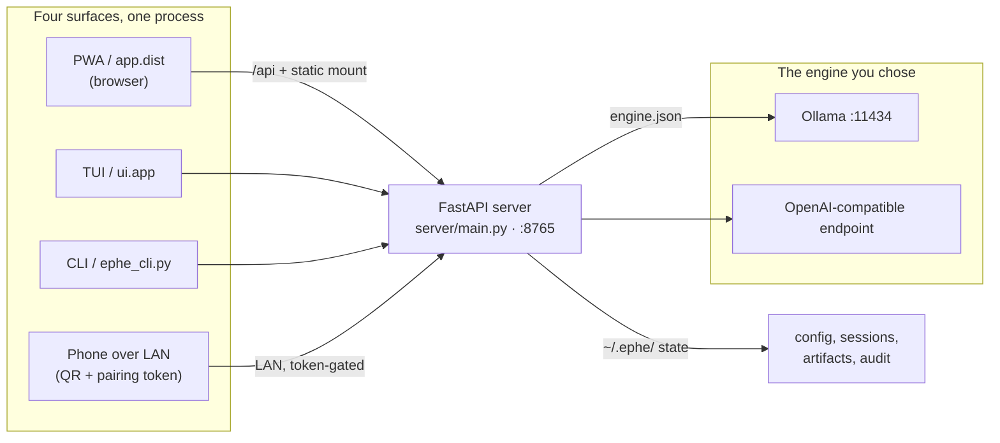

# Ephe — Architecture (status 2026-10-11)

An offline-first local AI agent: FastAPI backend + React 19 PWA, one process, one port.
This document is the source of truth for the system architecture.

## 1. Process and port topology



| Process | Port | Started by |
|---|---|---|
| FastAPI API + static PWA mount | `127.0.0.1:8765` (default, `--port`) | `run_server.py` |
| OpenAI-compatible engine (DGX/sglang/vLLM) | external, e.g. `:8888` | provider JSON `api_url` |
| Ollama (optional, BYO) | `:11434` | supplied by the user |

One backend serves four frontends: the PWA (`app/dist` mounted statically,
`server/main.py:341-387`), the TUI (`ui/app.py`), the CLI (`ephe_cli.py`), and mobile
via QR loopback/LAN token. `create_app()` = `server/main.py:152`; all routers under the
prefix `/api` (39 registrations, `server/main.py:273-311`), Swagger `/api/docs`
(`server/main.py:168`), security and rate-limit middleware wired at
`server/main.py:159-193`. The OpenAPI document carries 131 paths / 149 operations
(measured 2026-10-11 from `create_app().openapi()`); one file per route in
`server/routes/`.

## 2. Configuration (8 JSON files + env layering)

All runtime configs live in `~/.ephe/` (location: env `EPHE_CONFIG_DIR`,
`core/engine_config.py:230`), each written atomically (tmp + `replace`) with `0600`/`0700`.
Why JSON: native `json.loads` without an extra dependency, deterministic, fault-tolerant
(unreadable = "not configured"). TOML only where the tool demands it (`pyproject.toml`),
YAML only for infra (`docker-compose.yml`, `.github/*.yml`).

| File | Keys | Loader (file:line) |
|---|---|---|
| `engine.json` | `provider`, `model`, `api_url`, `workspace_dir` | `core/engine_config.py:319` |
| `image.json` | `base_url`, `api_key`, `model` | `core/image_config.py:40` |
| `voice.json` | `tts_engine`, `piper_voice`, `edge_voice`, `stt_model`, `stt_language` | `core/voice_config.py:48` |
| `security.json` | `approval_profile`, `sandbox_enabled` | `core/security_config.py:43` |
| `mcp.json` | `servers` (spec strings) | `core/mcp_config.py:23` |
| `skills_state.json` | `disabled[]` | `core/skills.py:53` |
| `settings.json` | settings register rows (`memory.inject_*`, `appearance.*`, `plugins.*`, `advanced.*`) | `core/settings_schema.py:249` |
| `hooks.json` | user tool hooks | `core/user_hooks.py:42-44` |

Separate files instead of one combined file, because `save_engine_config` would
discard foreign keys via `asdict(EngineChoice)` (`image_config.py:7-9`).
API keys never sit in `engine.json`, only in the session env (`engine_config.py:226`).

**Layering: `Env > file > default`.** Examples: `EPHE_IMAGE_BASE_URL` > `image.json`
> active chat engine (`image_tools.py:50-52`); `EPHE_MCP_SERVERS` > `mcp.json`
(`mcp_config.py:27`); `EPHE_WORKSPACE` > `engine.json` > `getcwd()`
(`workspace_rules.py:49`). Env only, no config file: `EPHE_CODE_EXEC`
(`cpython-cell|kernel`, default = cell once the guest is verified) and
`EPHE_CELL_MAX_FUEL` (`core/cpython_cell.py:83-84`). Under `~/.ephe/cells/` also live the
built guest (`cpython-wasi-<version>/`, never in git) and one `work/<session>/`
folder per session — the only writable point for model code.
`EPHE_*` overrides per module: engine `engine_config.py:58-67,226`, model tiers
`model_config.py:10-14`, tier force `model_router.py:83`, `EPHE_ENGINE_ROUTING`
`model_router.py:134`, detect timeouts `chat_prompt.py` + fallback model `chat_detect.py`,
MCP `mcp_config.py:27`, fetch reach `net_guard.py:55`, voice `voice_config.py:111`,
artifacts `artifact_store.py:35-38`, audit `audit_log.py:33`, learning
`learning_loop.py:88`, sessions `multi_session.py:37`, search DB
`session_search.py:46`, scheduler `scheduler.py:28,35,197`, memory
`memory_provider.py:44` + `auto_memory.py:112`.

## 3. The data path of a chat (stream chronology, R42)

```
POST /api/chat/stream            (routes/chat.py:1091)
  → agent path: chat_with_tools   (core/chat.py facade → chat_tools.py::_run_tool_loop)
       1) Detection: openai_compatible → chat_detect.py::_stream_detect_openai
          (idle timeout PER frame); Ollama non-streamed (chat_detect.py::_detect_tool_calls)
       2) Tool rounds ≤ clamp_tool_budget (MAX_TOOL_ITERATIONS=25,
          TOOL_BUDGET_HARD_CAP=40 core/chat.py, /ephe class 40 routes/chat.py:44);
          engine rounds stream for openai_compatible (chat_tools.py follow-ups);
          the declared repair budget is ephe_plan's MAX_REPAIRS_PER_STEP (chat_tools.py)
       3) Final: _emit_final_answer (chat_stream.py), detection_streamed → no
          double emission
  → SSE frames → lib/stream.ts streamChat (:85) → chunkBatcher → applyStreamEvent
    (34 frame types, lib/streamActions.ts::applyStreamEvent) called from
    components/dashboard/chat/model.ts::useChatLayoutModel
    → chatStore (Zustand facade store/chatStore.ts::useChatStore, split across
      store/chat/*) — blocks[] in arrival order (type: types/index.ts:133-138);
      appendChunk in store/chat/stream.ts::makeStreamActions, upsertToolCall in
      store/chat/tools.ts::makeToolActions
      → StreamBlocks (bubble/streamBlocks.tsx::StreamBlocks) →
        [TextBlockView | ToolStreamRows] (bubble/toolStreamRows.tsx::ToolStreamRows)
        per segment; stdout tail + done/total pair on the running line (R42)
```

`core/chat.py` is a facade since the 2026-10-11 split (1817 → 329 lines): the public
imports stay put, the six concerns live in `chat_stream` (`stream_response`,
`send_message_safe`, `_emit_final_answer`), `chat_prompt` (`assemble_system_prompt`,
native-thinking + detection-timeout policy), `chat_context` (`_fit_messages_to_window`,
tool-schema fit), `chat_detect` (`_detect_tool_calls`, `_stream_detect_openai`,
`_parse_tool_calls`), `chat_providers` (`_resolve_provider`, `_engine_reachable`,
`list_local_models`) and `chat_tools` (`_run_tool_loop`, `fence_tool_output`).
The 2026-10-11 frontend split moved `ChatInput` into `chat/*` composer modules,
`MessageBubble` into `bubble/*` and `StatusBar` into `statusBar/*`; the facades and
their submodules are mapped in §8.1. For split code the address is `module::symbol` —
a line anchor inside a split module is valid only for the revision it was read in,
because the split moved the bodies while the public names stayed.

Plan frame (#92): the plan is its own SSE frame, deduplicated as
`{"type": "plan", …}` (`routes/chat.py:819-827`), fed from two sources of the one
shape `core/ephe_plan.py` owns (`MAX_PLAN_STEPS` 8, `MAX_REPAIRS_PER_STEP` 2,
statuses pending/running/done/failed/cancelled): the checklist in the arriving
answer text (`EphePlan.try_from_markdown` per line segment, `:829-837`) and the
`todo_list` ledger (`EphePlan.from_ledger`, `:882-887`). The client parses the same
shape (`lib/planCardModel.ts`, parity test `planCardModel.parity.test.ts`) and
renders it (`PlanCard`, `bubble/assistantExtras.tsx`); the plan-mode guard instructs
it (`persona.py:71`).

The non-streaming `/chat` route and the scheduler drive the answer through
`react_loop` (`core/react.py:170`; `reflect()` exactly 1×, `MAX_REVISIONS=2` `:41`;
callers `routes/chat.py:665`, `core/scheduler.py:250-260`); the PWA stream calls
`reflect()` inline (`routes/chat.py:1435-1451`). Request-level tier resolution
(`force_tier`) and its `model_info` frame sit at `routes/chat.py:1181-1199`; the
loop-step router contract (`decide_loop_step`/`route_loop_call`/`bind_call`,
`core/model_router.py:187-266`) ships behind the opt-in switch
`EPHE_ENGINE_ROUTING` (`:134`, off by default) with branch tests
(`tests/test_hybrid_loop_router.py`) and no caller in the agent loop yet.

`/swarm <task>` branches in the same stream route into the swarm pipeline
(`routes/chat.py:912-926` → `run_swarm_v2`, `core/swarm_v2.py:939`): a manager
splits the task into subtasks, ≤8 parallel worker agents (`MAX_SWARM_AGENTS` `:112`)
run their own tool loops, results return as slim envelopes (cap 2000 chars `:58`),
state lives in `core/swarm_state.py`, the task lifecycle ledger in `core/a2a.py`;
the frames travel as `swarm_status`/`swarm_created`/`swarm_agent_started`/
`swarm_agent_done`/`swarm_done`.

Persistence: IndexedDB debounced (`lib/db.ts:160`), `flushPendingSave` on
visibility/unload (`:182-201`); orphan healing for `streaming=true`
(`store/chat/session.ts:17-22`). Cross-cutting: panel coupling via window events
(`lib/panelEvents.ts:9-12`), i18n `en` default via localStorage detection
(`app/src/i18n.ts:19-29`), 1515 keys at DE=EN parity (`locales/{en,de}.json`,
`lib/i18n-keys.test.ts`).

## 4. Tool surface (72 + MCP)

`TOOL_MAP` = `core/tools/registry.py:483-562`; dispatch `execute_tool` `:702`;
MCP `mcp_*` on a separate path `:773-777` (schemas appended dynamically `:982-986`).
Families (72 names incl. the zen-gateway aliases `bash`/`read`/`edit` `:501-505`):
tasks/agent (6), web (2), file (6), shell/sandbox/process (4), system/project (4),
vision (4), browser/GUI (11), sources (3), tests/verify (2), docs/artifacts (11),
deck (5), scaffold (1), meta tools (3), state/utility (5), workbench (2:
`read_transcript` + `read_cell_journal`, `core/tools/workbench_tools.py`).
Since wave E1 `execute_code` is no longer in-process exec but routes into the
CPython cell (§5) (`core/tools/code_kernel.py:74`); `run_sandboxed_code` stays the
path for prebuilt `.wasm` modules (`sandbox_tools.py:47`) — both reports go through
the same observability line.

Approval classes (`core/tools/approval.py`): SAFE 19 never blocked (`:24`);
CHAT_AUTO_RUN 28 (`:56`); SELF_GATED 8 (vision via `check_sandbox` `core/vision.py:197`,
browser via the URL reach policy `browser_url.py:57`) (`:100-109`); NETWORK 3
(`:114`); DANGEROUS 3 (`:121`); the remaining names count MUTATING — over the 72
registered tools: 48 MUTATING, 18 SAFE, 3 NETWORK, 3 DANGEROUS (`classify_tool`
`:155`).
The chat gate is ONE choke point (`core/tools/chat_gate.py:85`): model dispatch
and the meta-router `tool_call` (`discovery.py:271-277`) both run through
`confirm_for_chat` — an unknown name or a missing approval channel denies by
default (`approval.py:131-138`, `chat_gate.py:101-116`).
`run_shell` runs via `on_shell_confirm` (`core/chat_tools.py::_run_tool_loop`, wired at
`routes/chat.py:1249-1250`), segment-whitelist guard `validate_shell_command`
(`core/tools/_shell_validate.py:83`; runner `_shell_exec.py:62`). Audit: JSONL
`~/.ephe/audit.log` (`audit_log.py:33`), redacted via `core/redact.py`
(sk-/ghp_/gho_/hf_/xox[bp]-, Bearer/Basic; `:13-17`), `core/audit_log.py::audit_event`.
The `decision` field carries two axes: `approved`/`denied`/`session-approved` from the
approval layer, `blocked` from the reach layer (`core/quality.py::result_decision`
`:94`, on the marker prefixes) — `blocked` means: never executed, even though
`status=ok`.

## 5. Security

Loopback binding + LAN token (`X-Auth-Token`, `middleware.py:34,94`); rate limits:
costly routes (`chat/stream`, `shell`, `skills/install`, `vision/`) are ALWAYS
limited, desktop included, 20/60s (`middleware.py:164-173,194-199`), the general
400/60s budget only in LAN mode (`server/main.py:174-176`); `Content-Security-Policy:
frame-ancestors 'self'` (`middleware.py:137-160`); file tools stay inside the allowed
workspace roots (`core/tools/base.py:156-188`); the fetch reach guard
(`core/net_guard.py:1-28`, opt-in `EPHE_FETCH_ALLOW_PRIVATE` `:55`, wired at
`core/tools/fetch_tools.py:58-60`) blocks metadata/link-local hosts and pins the
checked address; channel content is data, never instruction
(`core/channels/injection_guard.py`, per inbound message `telegram_bot.py:488`);
approval profiles `strict|session` (`security.json`, `core/security_config.py:43-48`);
Seatbelt sandbox opt-in (`shell_sandbox.py`). STRIDE matrix:
`docs/SECURITY_THREAT_MODEL.md`.

**The third layer: execution (wave E1).** `execute_code` routes model Python into
a pinned CPython-WASI guest behind Ephemora Cell. The seam has two modules because
the questions are different: `core/cpython_guest.py` answers "is this interpreter
the one we built?" (manifest, entry hash on every load, stdlib-tree digest,
installation and session paths under `~/.ephe/cells/`), `core/cpython_cell.py`
answers "what follows from that?" (runtime choice, fuel/memory/disk/timeout caps,
start via `ephemora_cell.run_isolated`, report text, policy snapshot, doctor state).
The guest runs `core/cell_boot.py` — it compiles the model's program inside the guest,
keeps the session namespace as a pickle in `/work`, and reports the status in
`result.json` (the guest always exits with 0 so a guest error does not look like a
host crash). `EPHE_CODE_EXEC=kernel` is the explicit opt-out and names its consequence
in every result; an installed but unsuitable guest does **not** fall
back, it declines (`GUEST_UNVERIFIED`). Caps, measurements and the seam rationale:
`docs/SANDBOX_EXECUTION.md`. The UI shows the same numbers from one source:
`GET /api/settings/code-exec` → `policy_snapshot()` (read-only, secret-free;
`server/routes/settings.py:954-966`), and the
tool card in the panel carries the runtime chip from the result line.

## 6. Memory, persona, learning

- Short: `compact_history` ≤28 messages, folded down to 12-slot working memory (`conversation_compactor.py:21,71,146-150`).
- Long: one facade, two brains (`core/memory.py:11-21`): Chroma (existing installations) or Kepta (SQLite/FTS5, new installations); the choice is recorded in `~/.ephe/memory/provider.json` (`core/memory_provider.py:10-20,54-55`), `EPHE_MEMORY_PROVIDER` wins. Chroma embeds with MiniLM-L6-v2 (`memory_embed.py:25`), duplicate merge distance ≤0.08 (`memory_chroma.py:32`); the injection threshold is a register row (`memory.inject_min_score` default 0.3, `settings_schema.py:128`); ceiling `EPHE_MEMORY_MAX_ENTRIES=1000`, eviction only for `source=="auto_memory"` (`auto_memory.py:38-39,112`).
- Persona: `persona.md` (SOUL.md fallback, `persona.py:29-30,192-203`), 8000-character cap (`:31`), mode guards ask/plan/compute/page (`:58-140`), identity block from the harness (`build_identity_block` `:256-272`), model disclosed honestly, disclosure only.
- Learning loop: regex/heuristic, 0 model calls; `repeated_request` ≥3 + `correction` (`learning_loop.py:45-84`); proposal store JSON, cap 20 (`:28,92-131`), accept → `build_skill` (`:160`).
- Sessions: `~/.ephe/sessions/` with `registry.json` + one file per session (`multi_session.py:36-41`); PWA sessions mirrored under a `pwa-` namespace so the FTS5 index sees them (`server/routes/session_mirror.py`); `search.db` (`session_search.py:46`).

## 7. Tests and gates

| Gate | Location | Number |
|---|---|---|
| pytest (full, tracked) | `tests/` (389 files) | 4539 collected |
| Vitest (unit) | `app/src/**/*.test.tsx/.ts` (252) | 1654 (2 load flakes pass isolated) |
| Playwright | `app/tests/playwright/` (25 spec files incl. setup, 5 configs) | 157 listed (3 · 138 · 12 · 2 · 2) |
| tsc + eslint | `app/` | tsc clean; eslint 1 error / 61 warnings |
| sight-check (visual) | `scripts/sichtcheck_*.{mjs,py}` | fresh PNGs per pass |

Local entry point: `./scripts/run-tests.sh` (clears PYTHONPATH, uses `.venv`).
CI matrix py3.10–3.13 (`tests.yml:59`): `python -m pytest tests/ -q -n auto` with
four bench/wall-clock ignores (`tests.yml:228-232`). Not committed: `__pycache__`,
`node_modules`, `*.db*`, `.env*`, `docs/*.png|pdf|html` (generated).

## 8. Module map

Every top-level module of the repository, one line each.

| Module | Role |
|---|---|
| `core/` | engine core: chat loop, tool registry, memory, config, sandbox, swarms |
| `server/` | FastAPI app: the `/api` routes and middleware, plus the static PWA mount |
| `app/` | React 19 + Vite 6 PWA, the main product UI; Tauri desktop shell in `app/src-tauri/` |
| `ui/` | Textual TUI client over the same backend |
| `ephe_cli.py` | the `ephe` command: serve, configure, doctor, model and key management |
| `ephe.py` | the `ephe-app` console script: launches the Textual TUI |
| `run_server.py` | boots the FastAPI server on `127.0.0.1:8765` |
| `scripts/` | gates, CI helpers, and dev, eval and bench tooling |
| `evals/` | offline eval and benchmark harness, with its run receipts |
| `tests/` | pytest suite: the CI subset and the full maintainer run |
| `skills/` | built-in skill packs (markdown prompt packs) |
| `plugins/` | first-party plugin bundles (`ephe-plugin.json` manifests) |
| `knowledge/` | offline knowledge base (chunked markdown plus index) for retrieval |
| `utils/` | host network helpers: local IP detection, tunnel |
| `packaging/` | package manifests: Homebrew, npm, Scoop |
| `landing/` | static marketing landing page |

Top-level entry scripts: `install.sh`/`install.ps1` (installer), `setup.sh`, `dev.sh`.
`docs/` holds documentation (indexed in `docs/README.md`); `out/`, `.audit/`,
`.brandwork/` and `videos/` are generated working output, not modules.

### 8.1 Split modules (facade → submodule)

The 2026-10-11 module splits pull several large bodies apart. Each split keeps the old
import path as a **facade** — the public names and the seams the tests patch stay at
the old address — while the implementation moves into a subdirectory or sibling
modules. So the map below cites `module::symbol`: the split moved the bodies, and a
line inside a split module describes one revision only.

**Core chat engine — `core/chat.py` (facade).** The body is split 1:1 into six
siblings; `core/chat.py` re-exports every public name and keeps the patched seams
bound at the facade (`ollama`, `asyncio`, `build_provider_client`, `execute_tool`,
`_tool_detection_timeout`), so callers and monkeypatch sites keep working unchanged.

| Module | Owns |
|---|---|
| `core/chat_stream.py` | `stream_response`, `send_message_safe`, `_emit_final_answer`, `stream_with_retry`, `ThinkingStreamParser`, the engine exception types (`OllamaNotReachableError`, `EngineNotReachableError`, `OllamaModelBusyError`, `OllamaModelNotFoundError`) |
| `core/chat_prompt.py` | `assemble_system_prompt`, `_assemble_system_prompt_into`, `supports_native_thinking`, the native-thinking model table and the `_tool_detection_timeout` classification |
| `core/chat_context.py` | `_fit_messages_to_window`, `_active_context_window`, `_cap_tool_result`, `_tools_for_messages`, `_cached_tool_schemas` (window, result caps, tool-schema cache) |
| `core/chat_detect.py` | `_detect_tool_calls`, `_stream_detect_openai`, `_parse_tool_calls`, `_follow_up_with_retry`, `_finalize_budget_exhausted` |
| `core/chat_providers.py` | `_resolve_provider`, `_engine_reachable`, `list_local_models`, `list_local_model_options`, `check_ollama_connection`, `check_engine_connection` |
| `core/chat_tools.py` | `_run_tool_loop`, `fence_tool_output`, `is_untrusted_tool`, `untrusted_origin_tool` |

**Chat store — `app/src/store/chatStore.ts` (facade `useChatStore`).** The body is
split across `store/chat/*`; the facade re-exports every slice and the store's own
docstring carries the same map.

| Module | Owns |
|---|---|
| `store/chat/types.ts` | `ChatState`, `StoreCtx`, `SetFn`/`GetFn`, `ToolCallModel` |
| `store/chat/helpers.ts` | `toDbSession`, `fromDbSession`, `updateActiveMessage`, `closeThinkingPhases`, `indicatorMessage`, `deriveSessionTitle`, defaults |
| `store/chat/persist.ts` | `makePersistActive`, `makeSetTransientMeta`, `makeMarkSandboxStatus` |
| `store/chat/session.ts` | `makeSessionActions` (load, send, compact, branch, edit) |
| `store/chat/stream.ts` | `makeStreamActions` (in-place streaming, `appendChunk`, TTFT, thinking phases) |
| `store/chat/helper.ts` | `makeHelperActions` (the helper as its own session) |
| `store/chat/tools.ts` | `makeToolActions` (`upsertToolCall`, activities, sandbox tokens) |
| `store/chat/checkpoints.ts` | `makeCheckpointActions` |

**Dashboard surfaces — `app/src/components/dashboard/`.** Six surfaces split their
bodies into sibling directories. `ChatLayout.tsx`, `AgentPanel.tsx` and
`SettingsPanel.tsx` are pure re-export facades; `ChatInput.tsx`, `MessageBubble.tsx`
and `StatusBar.tsx` keep a thin body and import piece by piece from their subdirectory.

| Facade | Submodules | Pattern |
|---|---|---|
| `ChatLayout.tsx` | `chat/index.tsx` (`ChatLayout`), `chat/model.ts` (`useChatLayoutModel`) + `chat/use*` hooks | re-export |
| `ChatInput.tsx` | `chat/Composer*.tsx`, `chat/useComposer*.ts`, `chat/composerPopups.ts`, `chat/composerModelEntries.ts`, `chat/contextRing.ts` | delegation |
| `MessageBubble.tsx` | `bubble/` — `assistantBubble`, `assistantExtras`, `messageMarkdown`, `streamBlocks`, `toolStreamRows`, `bubbleActions`, `sourcesBar`, `turnHeadRow` | delegation |
| `StatusBar.tsx` | `statusBar/` — `ConnectionPill`, `ContextWindowsPopover`, `CostChips`, `StorageFootprint`, `windowHint` | delegation |
| `AgentPanel.tsx` | `agent/` — `index.ts` → `panel.tsx` (`AgentPanel`), `tabsA`/`tabsC`/`tabsMemory`/`tabsSideConversation`/`tabsSubagents`/`tabsTrajectory`, `trajectoryParts`, `LiveTerminal`, `filesTab`, `previewTab`, `reviewTab`, `terminalTab`, `auditTab` | re-export |
| `SettingsPanel.tsx` | `settings/index.tsx` + `settings/model/*` (engine, image, memory, mcp, plugins, hooks, …) | re-export |

Route-level code-splitting sits one level above these splits: `app/src/App.tsx`
lazily imports the five pages (`ChatPage`, `SetupPage`, `MemoryPage`,
`ArtifactsPage`, `ToolsPage`). `pages/ChatPage.tsx` is a one-line wrapper over
`ChatLayout`. Inside the chat layout the two heavy panes are their own lazy chunks
as well (W3-1): `chat/index.tsx` declares `lazy(() => import('../AgentPanel'))`
(xterm plus the agent tabs) and `lazy(() => import('../ArtifactRail'))`, each behind
its own `<Suspense>`, so the chat entry chunk no longer carries either pane. The pane
event constants `PREVIEW_OPEN_EVENT` / `PANEL_STATE_EVENT` moved to the leaf module
`@/lib/panelEvents` so `ToolbarRow` and the lazy AgentPanel stop importing each other;
`agent/index.ts` re-exports them for existing callers. The chunk budgets are gated by
`app/scripts/bundle_budget.py`.

Sizes (verification anchors): `core/` 117 modules (six from the 2026-10-11 chat split),
`server/` 46, `app/src` 576 files, `ephe_cli.py` 1 (1851 lines), `skills/` 51 pack
directories + `pack-index.json` (5 curated packs: office, dev, business, writing,
research).
Latency budgets as tests: `tests/test_r25_latency_budgets.py`.
Stress: the 1000-message campaign `scripts/stress_1000_messages.py` (measured p50 37 s,
p95 54.8 s).

## 9. Topology summary

```text
Browser PWA
  -> FastAPI server
    -> Provider router
      -> engine chosen in-app: local Ollama, remote Ollama, or OpenAI-compatible (DGX)
      -> explicit --model/--api-url flags override the persisted choice

Core modules
  -> chat, tools, vision, memory, skills, scheduler, profile
```

## 10. Change sets and the agent fleet

**A change set with provenance, behind a review gate that refuses self-approval.** Every edit an
agent makes is recorded as a change set: the paths it touched, a sha256 digest of each file's diff,
and the provenance — the session, the agent and the reason it gives for existing. A set reaches your
trunk only on a verdict from a reviewer other than its author, and every verdict has to carry a
located reason (`path:line:why`). The gate refuses an author's approval of its own work, and it
refuses a publish that has no verdict behind it — a dry run included, because a dry run that says
"this would land" about a set the gate turns down answers the wrong question.

**A fleet of agents, each in its own worktree.** An agent run gets its own git worktree on its own
branch, so parallel runs never share a working tree. `ephe agents` lists the live ones with their
state read back from git; `ephe reap` collects the ones whose owning process is gone.

Both are readable from a terminal and from the app's workspace page.

## 11. Runs anywhere (experimental)

`run_shell` carries an opt-in execution backend: set
`EPHE_SHELL_BACKEND=docker` and commands execute inside a per-workspace
container (workspace mounted at `/workspace`, image configurable via
`EPHE_DOCKER_IMAGE`, default `python:3.12-slim`). Unusable daemon means
a clear config error — never a silent local fallback. The macOS Seatbelt
sandbox always wins when active. More backends (SSH, serverless) are tracked
in [#19](https://github.com/bemlerlabs/ephe/issues/19).
