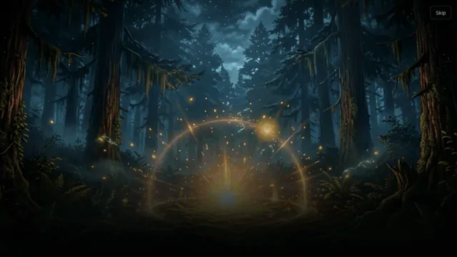
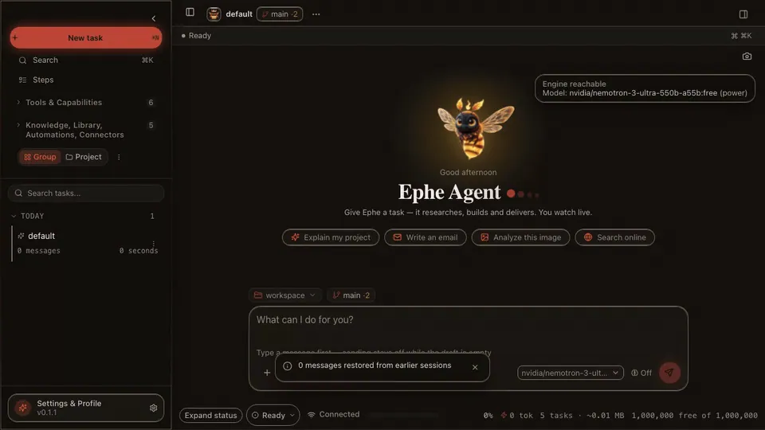
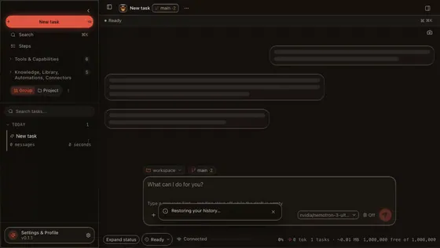
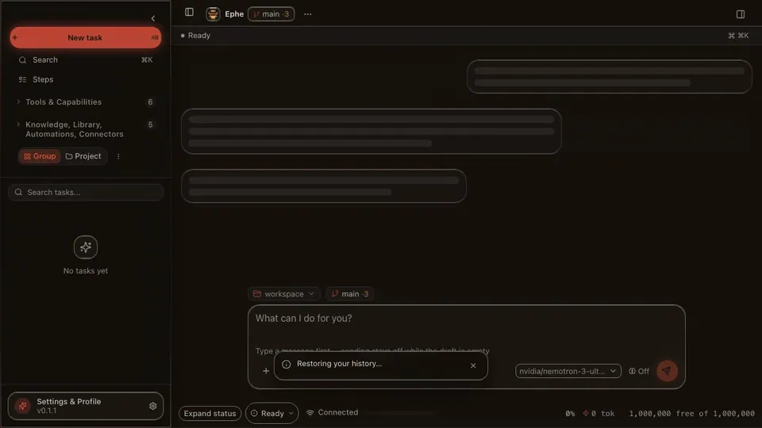
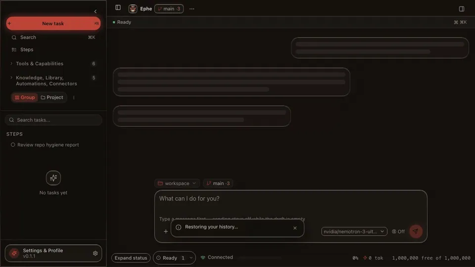
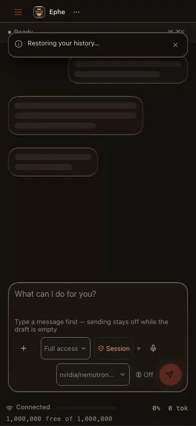
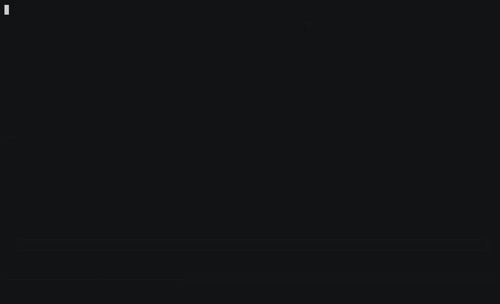
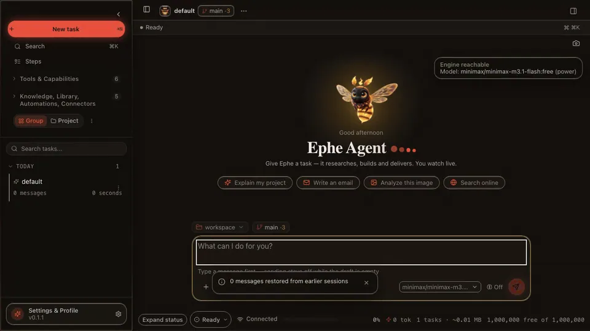
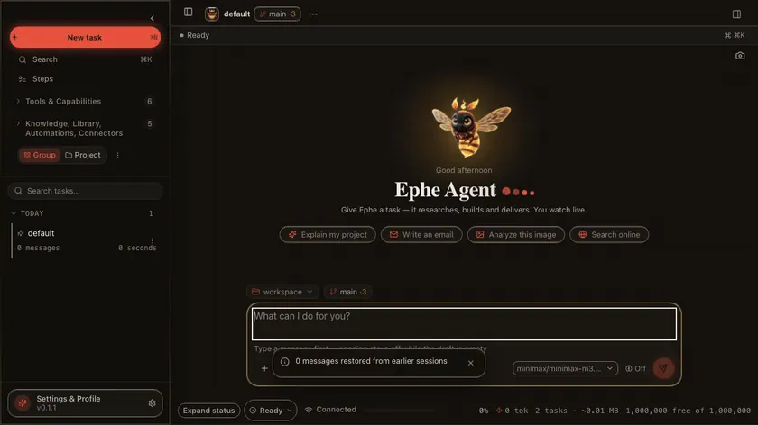

# Demos

Short recordings of the React PWA against the FastAPI backend, and of the terminal
against the same engine. The artifact clips drive the real local tools and need no
network; the chat clips stream from the configured engine.

| Onboarding | Chat & thinking | Artifacts (SVG + Excel) |
|---|---|---|
|  |  |  |
| The first open: the awakening film, then the four questions that set up the desk | Streaming answers with a separate thinking channel | Artifact tools create real files with inline preview |

| Agent Panel | Command palette & navigation | Plugin Store | Mobile PWA |
|---|---|---|---|
|  |  |  |  |
| Git diffs, tasks, and a shell with approval gates | ⌘K palette, session rename, shortcut cheatsheet | Extensions 1.0: master switch, detail sheet, signed bundles | Same app on a phone viewport |

| Terminal | Read a workspace | Write a deliverable |
|---|---|---|
|  |  |  |
| `ephe tui` in a real pty: approvals, tool rows, the answer | A CSV in the workspace, answered in euros from the rows | plan.md turned into launch_checklist.md, opened as a file |

The terminal clip forks a pty, types the keyboard the product documents, and renders the
byte stream with `agg`, so the frames are the terminal. The other clips record the PWA at a
desktop viewport, which is the same web content the Tauri app embeds.

## Provenance

All clips were captured on 2026-10-23 from the built PWA (`app/dist`) served by a local
backend with an isolated temporary `HOME` and a local stub engine. No paid model was called
and no key was used. They predate 0.6.3, which moved the response mode from the composer to
the header, so the top bar in the clips still shows the old control. Re-record them with the
header mode control before the next release.
