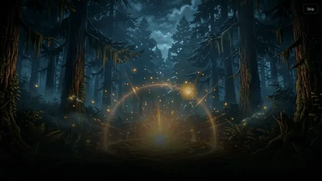
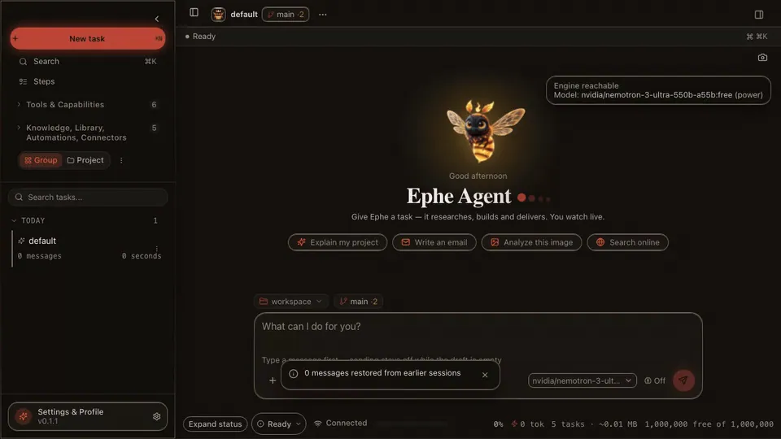
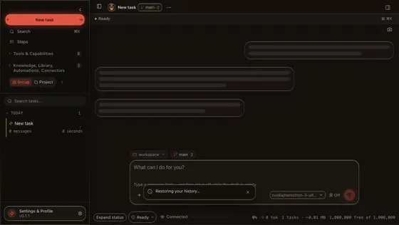
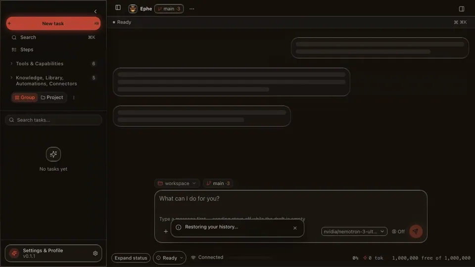
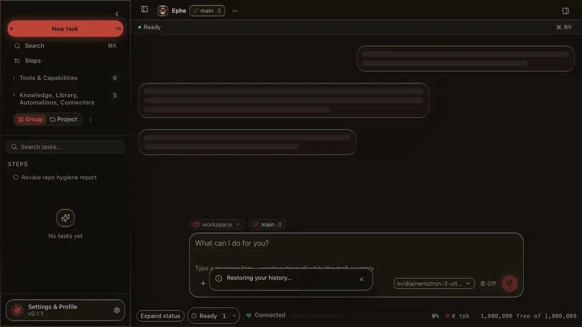
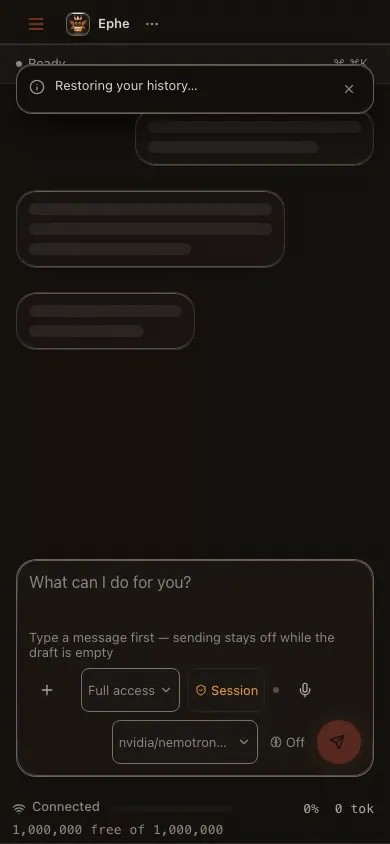

# Demos

Screen recordings of the real app — the React PWA against the FastAPI backend — captured with
`scripts/create_demo_media.py`. The artifact clips drive the real local tools and need no network; the
chat clip streams from the configured engine.

| Onboarding | Chat & thinking | Artifacts (SVG + Excel) |
|---|---|---|
|  |  |  |
| The first open: the awakening film, then the four questions that set up the desk | Streaming answers with a separate thinking channel | Artifact tools create real files with inline preview |

| Agent Panel | Command palette & navigation | Plugin Store | Mobile PWA |
|---|---|---|---|
|  |  |  |  |
| Git diffs, tasks, and a shell with approval gates | ⌘K palette, session rename, shortcut cheatsheet | Extensions 1.0: master switch, detail sheet, signed bundles | Same app on a phone viewport |

Regenerate them with `./dev.sh` running, plus `ffmpeg`, `gif2webp` and Python `playwright`:

```bash
./.venv/bin/python scripts/create_demo_media.py
```
