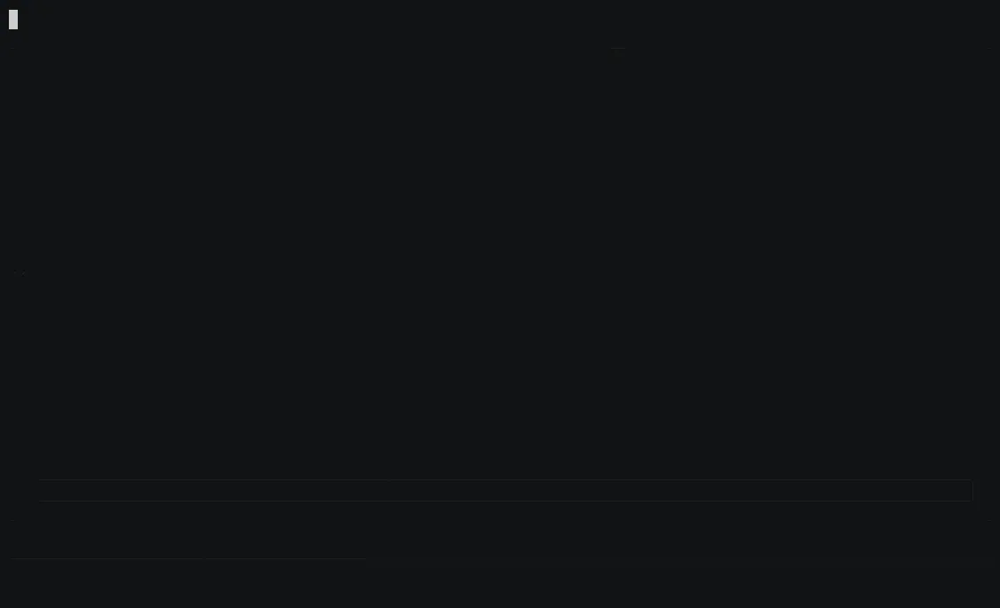
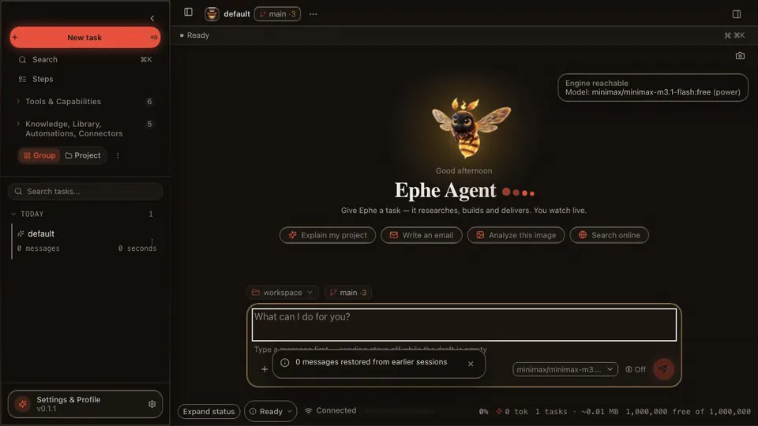
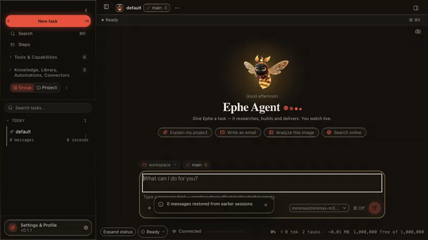

# Demos

Recordings of the real product — the React PWA against the FastAPI backend, and the terminal
against the same engine — captured by the maintainers' recorder, which is not in the public tree. The artifact clips drive
the real local tools and need no network; the chat clips stream from the configured engine.

| Onboarding | Chat & thinking | Artifacts (SVG + Excel) |
|---|---|---|
|  |  |  |
| The first open: the awakening film, then the four questions that set up the desk | Streaming answers with a separate thinking channel | Artifact tools create real files with inline preview |

| Agent Panel | Command palette & navigation | Plugin Store | Mobile PWA |
|---|---|---|---|
|  |  |  |  |
| Git diffs, tasks, and a shell with approval gates | ⌘K palette, session rename, shortcut cheatsheet | Extensions 1.0: master switch, detail sheet, signed bundles | Same app on a phone viewport |

| Terminal | Read a workspace | Write a deliverable |
|---|---|---|
|  |  |  |
| `ephe tui` in a real pty: approvals, tool rows, the answer | A CSV in the workspace, answered in euros from the rows | plan.md turned into launch_checklist.md, opened as a file |

The terminal clip is the one exception to the Playwright route: the recorder forks a pty,
types the keyboard the product documents, and renders the byte stream with `agg`, so the
frames are the terminal. The other clips record the PWA at a desktop viewport, which is the
same web content the Tauri app embeds.

Regenerate them with `./dev.sh` running, plus `ffmpeg`, `gif2webp`, `agg` and Python `playwright`:

```bash
# The recorder is maintainer-only; the published clips above are the artifact.
```
